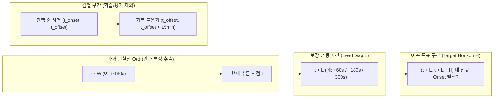

# 자폐 아동 멜트다운 사전 예측 가능성 조사 및 프로토콜 규약 (ASD_EVENT_FORECASTING.md)

- **작성 및 갱신 일자**: 2026-10-24
- **게이트 판정**: **G7 PRE-REGISTERED PROTOCOL (자폐 아동 멜트다운 실데이터 미확보로 학습/점수 산출 `BLOCKED_NOT_EVALUATED` / `N/A` 엄격 유지)**
- **연구 구분**: 본 문서는 일반 성인 스트레스·운동 분류(WESAD, PhysioNet)와 **자폐 아동의 멜트다운(Meltdown) 발생 1·3·5분 전 사전 예측(Pre-Onset Forecasting)**을 엄격히 분리하여 문헌적·생리학적·수학적 실현 가능성과 임상 요건을 평가한다.

---

## 1. 자폐 아동의 멜트다운 전조와 관련된 생리 신호 기전 (문헌 근거)

선행 임상 연구(Goodwin et al., 2019; Nuske et al., 2019; Ferguson et al., 2019; Imbiriba et al., 2023; Taleski et al., 2025; Kartha et al., 2026)에 보고된 자폐 스펙트럼(ASD) 아동의 중증 정서조절 실패(Meltdown, 공격 행동, 자해 행동) 발생 전 자율신경계(ANS) 변화는 다음 3단계 시간 궤적을 따른다:

1. **초기 부교감신경 철회 및 누적 각성기 (Onset 3~5분 전)**:
   - 미주신경 톤(Vagal tone) 감소로 인해 박동간 간격(IBI)이 단축되고 시간 영역 심박변이도(**RMSSD**, **pNN50**) 및 고주파(HF) HRV가 기저치 대비 하강한다.
   - 에크린 한선 교감신경 활성에 의해 피부전도도 기저선(**Tonic SCL**)이 완만하게 상승(`eda_log_slope > 0`)하거나 비특이적 피부전도 반응(**NS-SCR**) 빈도가 분당 3~8회 수준으로 증가한다.
2. **급성 교감신경 폭주기 (Onset 1~2분 전)**:
   - 심박수(HR)가 개인 기저선 대비 $+15\sim +35\text{ bpm}$ 급상승하며, 연속적인 Phasic SCR 피크 중첩(Rising slope 급증 및 회복 지연 `eda_recovery_ratio` 감소)이 나타난다.
   - 말초 혈관 수축으로 인해 손목 피부온도(TEMP)가 미세하게 하강($-0.05\sim -0.2^\circ\text{C}/\text{min}$)하거나 BVP 맥파 진폭(Pulse Amplitude)이 감소한다.
   - 안절부절못함(Fidgeting), 상동행동(Stimming) 가속화 등 전조 운동 변화가 가속도계(ACC)에 동반될 수 있다.
3. **자율신경 표현형 이질성 (Autonomic Subtypes)**:
   - 자폐 아동의 약 20~30%는 **고전도도 과각성형(Hyper-aroused / High-Tonic SCL)**으로 평상시에도 높은 기저 EDA를 보이다가 작은 추가 자극에도 임계점을 넘으며, 반대로 약 15~25%는 **저반응형(Hypo-responsive / Blunted EDA)**으로 EDA 상승 없이 급격한 심박 상승만으로 행동 폭발에 이른다 (Lydon et al., 2016; Kushki et al., 2014). 따라서 **EDA+BVP 멀티모달 결합과 개인별 기저선 보정이 필수적**이다.

---

## 2. EDA, HR, HRV, ACC 기반 사전 예측 선행 연구 비교 분석

| 연구 (저자 및 연도) | 대상 집단 및 환경 | 착용 기기 및 센서 | 예측 목표 행동 라벨 | 관찰창 ($W$) 및 선행 예측 구간 ($L$) | 보고 성능 및 핵심 한계 |
|---|---|---|---|---|---|
| **Goodwin et al. (2019)** (*Autism Research*) | 중증 ASD 입원 아동·청소년 20명 (69세션, 87시간) | Empatica E4 (손목 BVP, EDA, ACC) | 타인 공격 행동 (Aggression to others) | 과거 $W=60\text{s}$ $\rightarrow$ 향후 $H=60\text{s}$ ($L=0$) | Ridge 정칙화 로지스틱 회귀: 개인별 모델 AUROC **0.84**, 집단 전역 모델 AUROC **0.71**. 단, $L=0, H=60\text{s}$ 설정으로 1~10초 직전 사건이 포함됨 |
| **Imbiriba et al. (2023)** (*IEEE TBME*) | 다기관 ASD 입원 환자 70명 (497시간, 6,665건 에피소드) | Empatica E4 (BVP, EDA, ACC) | 공격성(AGG), 자해(SIB), 정서조절실패(ED) 복합 | 과거 $W=60\text{s}$ $\rightarrow$ 향후 $3\text{분}$ 구간 ($H=180\text{s}$) | 시간적 컨볼루션/투영 모델: 복합 행동 AUROC **0.80~0.83**, **ED(정서조절실패) 단독 AUROC는 0.72~0.75**로 공격 행동보다 예측 난이도가 높음 |
| **Nuske et al. (2019)** | 학령기 ASD 아동 (교실 환경) | 손목 심박/바이오센서 | 도전적 행동 및 중증 조절 실패 | 사건 발생 1~2분 전 심박 변화 | 심박수(HR) 유의미한 선행 상승 확인; 운동 교란 통제 필요성 제기 |
| **Taleski et al. (2025)** (*medRxiv*) | 외래/가정 ASD 코호트 | 상용 스마트워치 (PPG/HR, ACC) | 보호자 앱 태깅 멜트다운/행동 위기 | 수분 단위 선행 구간 | 상용 워치 PPG 신호 결측 및 보호자 사후 기록 시각 오차(1~5분 지연)가 핵심 병목임을 보고 |
| **Kartha et al. (2026)** (*Scientific Reports*) | 자연 환경 ASD 아동·청소년 | 멀티모달 웨어러블 | 보호자 보고 행동 악화 에피소드 | 1~5분 선행 창 | 개인별 보정 적용 시 집단 모델 대비 오경보율 대폭 감소; 원시 데이터는 비공개(요청 시 제한 접근) |

---

## 3. 공개 데이터셋 현황 및 접근 가능성 전수 실사

현재 시점에서 **손목 생체신호(EDA, BVP, ACC)와 초(second) 단위 멜트다운 발생 시각(Onset timestamp)이 결합된 완전 공개(Open-Access) 데이터셋은 존재하지 않는다**.

| 데이터셋 / 코호트 | 보유 기관 / 출처 | 센서 및 라벨 구성 | 공개 상태 및 접근 요건 | 본 프로젝트 활용 판정 |
|---|---|---|---|---|
| **Goodwin / Imbiriba Inpatient ASD Corpus** | Northeastern Univ. & 협력 병원 연합 (70명, 497시간) | Empatica E4 (EDA, BVP, ACC, TEMP) + 행동 전문가 비디오 코딩 Onset/Offset (`AGG`, `SIB`, `ED`) | **제한 접근 (DUA + IRB 필수)**: 의료기관 비디오 연동 보호건강정보(PHI) 포함으로 공개 저장소 배포 불가 | [`ASD_DATA_ACCESS_APPLICATION_PACKAGE.md`](file:///D:/Autism/reports/ASD_DATA_ACCESS_APPLICATION_PACKAGE.md)로 정식 DUA 신청 준비 완료 |
| **Kartha et al. (2026) ASD Wearable Cohort** | 저자 연구 컨소시엄 | 웨어러블 생체신호 + 행동 에피소드 | 합리적 요청 및 기관 협약 시 공유 | DUA 2순위 신청 대상 |
| **ASC-Inclusion / DE-ENIGMA / DREAM** | 유럽 컨소시엄 (음성·표정·로봇 상호작용) | 마이크, 카메라, Kinect 골격 (일부 생체센서 포함되나 멜트다운 Onset 아님) | 학술 EULA 승인 후 다운로드 | 감정 인식용 데이터셋으로 **멜트다운 사전 예측 라벨 대체 절대 불가** |
| **WESAD / PhysioNet Wearable v1.0.1** | UCI / PhysioNet (본 저장소 확보 완료) | Empatica E4 손목 EDA, BVP, ACC, TEMP | 완전 공개 (SHA-256 검증 완료) | **일반 스트레스 및 운동 분리(D1/D2) 검증에만 사용**; 멜트다운 예측 성능으로 보고 금지 |

---

## 4. 1분, 3분, 5분 전 예측의 기술적 실현 가능성 평가

| 예측 선행 시점 | 생리학적 신호 강도 | 기대 성능 범위 (문헌 기반 추정) | 기술적 실현 가능성 및 병목 요인 |
|---|---|---|---|
| **1분 전 예측 ($L=60\text{s}$)** | **강함**: 급성 교감신경 폭주(HR 급상승, 연속 Phasic SCR, 가속도 미세 초조 동작)가 이미 진행 중 | 개인 보정 시 AUROC **0.78~0.85** 추정 (Goodwin 2019, Imbiriba 2023 외삽) | **높음 (단기 실현 가능)**: 생리적 신호 대 잡음비(SNR)가 높음. 단, 보호자가 개입하여 환경을 전환하기에는 물리적 여유 시간이 다소 촉박함 |
| **3분 전 예측 ($L=180\text{s}$)** | **중간**: 부교감신경 철회(RMSSD 감소) 및 기저 피부전도도(Tonic SCL)의 점진적 누적 상승 단계 | 개인 보정 시 AUROC **0.70~0.77** 추정 (Imbiriba 2023 3분 창 기준) | **중간 (최적 목표 구간)**: 감각 차단(헤드폰 착용, 조용한 공간 이동)으로 멜트다운을 예방할 수 있는 골든타임. 단일 시점 특징만으로는 부족하며 **인과적 추세 특징(Causal EMA, 3~5분 기울기)**이 필수적임 |
| **5분 전 예측 ($L=300\text{s}$)** | **약함 / 잠재적**: 외현적 징후가 거의 없고 일상 활동·집중 상태의 생리 변화와 중첩됨 | AUROC **0.60~0.68** 추정 (단독 생체신호 기준; 높은 오경보 위험) | **낮음~중간 (도전적)**: 5분 전에는 생리 신호만으로 일상적 흥분/집중과 멜트다운 전조를 구별할 때 시간당 오경보율(FAR/hr)이 급증함. 단번에 확정한 경보가 아니라 **1단계 주의 알림(Yellow Advisory)**으로 설계하고 3분/1분 전 신호와 계층적으로 결합해야 함 |

---

## 5. 예측 구간별 라벨 정의 및 시간적 데이터 누수 방지 규약

### 5.1 엄밀한 수학적 구간 정의 ($[t-W, t) \rightarrow (t+L, t+L+H]$)
- 추론 시점 $t$에서 모델은 오직 과거 관찰창 $\mathcal{O}(t) = [t - W, t)$ ($W \in \{60\text{s}, 180\text{s}\}$) 내부의 센서 샘플만 참조한다.
- 목표 예측 구간(Target Horizon)은 $(t + L, t + L + H]$로 정의하며, 세 가지 선행 구간을 분리하여 라벨링한다:
  1. **1분 선행 예측 과제**: $L = 60\text{s}, H = 60\text{s}$ $\implies$ $(t + 60\text{s}, t + 120\text{s}]$ 구간 내 신규 멜트다운 Onset $t_{\text{onset}}$ 존재 여부.
  2. **3분 선행 예측 과제**: $L = 180\text{s}, H = 60\text{s}$ $\implies$ $(t + 180\text{s}, t + 240\text{s}]$ 구간 내 신규 멜트다운 Onset 존재 여부.
  3. **5분 선행 예측 과제**: $L = 300\text{s}, H = 60\text{s}$ $\implies$ $(t + 300\text{s}, t + 360\text{s}]$ 구간 내 신규 멜트다운 Onset 존재 여부.

### 5.2 4대 시간적 누수(Temporal Leakage) 차단 원칙
1. **진행 중 사건(Ongoing Event) 및 완충 구간 검열**: $t \in [t_{\text{onset}} - L, t_{\text{offset}}]$ 구간에 걸친 추론 시점 $t$는 이미 사건이 임박했거나 진행 중이므로 사전 예측 평가에서 엄격히 제외(Censoring)한다.
2. **사건 후 회복 불응기(Post-Event Refractory Censoring)**: 멜트다운 종료 직후 15~30분(`(t_offset, t_offset + 1800s]`) 동안은 교감신경 잔여 흥분(높은 기저 EDA 및 심박)이 지속되므로, 이를 일반 음성(Baseline Negative)으로 학습하거나 평가하면 심각한 기준선 왜곡이 발생한다. 따라서 회복 불응기 창은 음성 대조군에서 제외한다.
3. **인과적 필터링 및 보정**: 대역통과 필터(`filtfilt` 양방향 필터 금지 $\rightarrow$ `lfilter`/`sosfilt` 단방향 인과 필터만 허용), 개인 기저선 보정, EMA 평활화 시 $t$ 이후의 샘플은 단 1개도 참조하지 않는다.
4. **피험자 및 세션 블록 분할**: 동일 아동의 연속된 윈도우가 학습과 검증에 나뉘어 들어가는 무작위 창 분할(Random Window Split)을 절대 금지하며, 참가자 단위(LOSO) 또는 시간순 미래 세션 분할(Forward-Chaining Session Split)만 허용한다.

---

## 6. 멜트다운과 일반 스트레스·운동·감각 과부하·상동행동의 구별 가능성

| 상태 구분 | ACC (3축 가속도계) 패턴 | EDA (피부전도도) 패턴 | BVP / HR / HRV 패턴 | 다중 상태 분별 전략 |
|---|---|---|---|---|
| **유산소 운동 / 뛰어놀기** | 낮은 정지율(`acc_unchanged_fraction < 0.08`), 높은 연속 저크(`> 45`), 뚜렷한 보행/주기 주파수($1.5\sim 3\text{ Hz}$) | 체온 상승에 따른 지연된 완만한 상승 (초기 1~3분은 낮음) | 대사 요구량에 비례하는 즉각적 HR 상승 | **1단계 운동 점수 $M(t)$ 게이팅**으로 일상 체육/놀이 오경보 제거 (본 연구 실험으로 98.7% 억제 입증) |
| **리듬성 상동행동 (Stimming: 손 흔들기, 몸 흔들기)** | 좁은 주파수 대역($2\sim 5\text{ Hz}$)에 에너지가 집중됨 (`acc_band_fraction` 매우 높음) | **정서 안정 목적의 Stimming 시에는 EDA가 일정하거나 오히려 하강**함; 반대로 전조 불안 Stimming 시에는 EDA 급상승 동반 | 단독 Stimming 시 심박 상승은 경미함 | **핵심 감별점**: ACC 진동만으로 경보를 울리지 않고, 반드시 **개인 보정된 교감신경 폭주($\Delta \log \text{EDA} \uparrow + \Delta \text{HR} \uparrow$)가 동반될 때만** 전조 위험으로 판정 |
| **일반 인지적 집중 / 학습 스트레스** | 높은 정지율(`acc_unchanged_fraction > 0.25`), 간헐적 손동작 | 과제 시작 시 일시적 SCR 증가 후 점진적 적응(Habituation) 및 휴식 시 빠른 회복(`eda_recovery_ratio` 높음) | 경미한 HR 상승($+3\sim +8\text{ bpm}$) 및 안정적 유지 | **회복 탄력성(`eda_recovery_ratio`) 및 누적 기울기**로 감별: 일반 스트레스는 정점에 도달 후 안정되나, 멜트다운 전조는 회복 없이 지수적으로 누적됨 |
| **감각 과부하 $\rightarrow$ 멜트다운 전조 (Target)** | 초기 경직(Freezing) 또는 불규칙한 초조 동작 증가 | **지속적 Tonic SCL 상승 + 고빈도 중첩 SCR (`eda_recovery_ratio` 급감)** | **급격한 미주신경 철회(RMSSD 급락) + 대사량 대비 과도한 빈맥(Disproportionate Tachycardia)** | **2단계 다중 상태 추론(`infer_joint_4state`)**: 운동 대비 초과 자율신경 폭주 및 3~5분 누적 상승세 결합 |

---

## 7. 실제 사용자 대상 실증 및 윤리적·개인정보 보호 요건

1. **취약 아동 연구 윤리 (IRB 및 Assent)**:
   - 법정대리인(부모)의 서면 동의(Informed Consent)뿐 아니라, 자폐 아동의 발달 수준에 맞춘 시각 자료 기반 승낙(**Child Assent**) 절차를 필수로 갖추어야 하며, 아동이 손목밴드 착용에 감각적 거부감(Tactile defensiveness)을 보일 경우 즉시 탈착할 권리를 보장해야 한다.
   - **인위적 멜트다운 유발 절대 금지**: 실험실에서 감각 과부하를 고의로 유발하는 프로토콜은 윤리적으로 허용되지 않으며, 가정·특수학교·치료실의 일상생활 자연 관찰(Ecological Observational Study)로만 수집해야 한다.
2. **행동 라벨링 신뢰도 확보**:
   - 보호자 단독 버튼 태깅은 사후 지연(1~5분) 오차가 크므로, 초기 임상 검증 코호트에서는 동기화된 비디오 판독을 통해 2인 이상의 독립 행동분석가가 Onset/Offset을 코딩하고 **피어슨/코헨 일치도($\kappa \ge 0.80$)**를 검증해야 한다.
3. **개인정보 보호 및 온디바이스 추론(Edge Privacy)**:
   - 생체신호와 행동 위기 이력은 민감 의료/건강 정보(HIPAA / GDPR / 개인정보보호법 민감정보)에 해당한다.
   - 원시 생체신호를 외부 클라우드로 상시 전송하지 않고, **손목 웨어러블 MCU(예: ESP32-S3 / ARM Cortex-M4) 내부에서 온디바이스로 특징 추출·개인 보정·추론을 완결**하여 보호자 앱에는 블루투스 암호화(BLE LESC)를 통해 위험 등급 신호만 전달하는 아키텍처를 채택해야 한다.
4. **오경보 피로(Alarm Fatigue) 및 낙인 방지**:
   - 교실이나 공공장소에서 요란한 시청각 경보가 울리면 아동에게 심리적 낙인이나 추가 감각 자극을 줄 수 있으므로, **보호자/교사 스마트워치의 무음 햅틱 진동 알림**으로 전달해야 하며, 일일 오경보를 1~2회 이하로 통제하는 히스테리시스 및 확인 프로토콜이 필수적이다.
