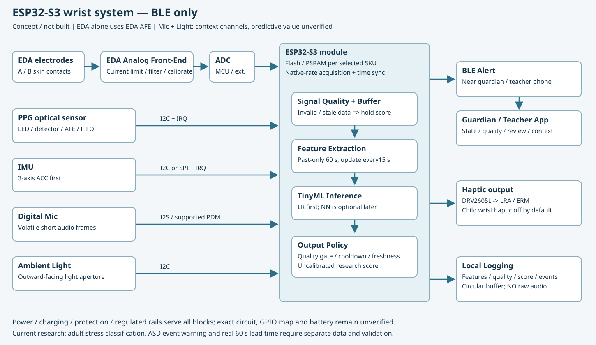
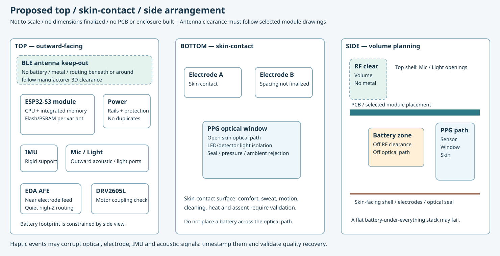

# 자폐 아동 생체신호 기반 조기 위험 알림 연구 — 통합 실행 보고서

기준일: 2026-10-23. 최신 붙여넣은 마스터 명세 v1.0을 적용했다. 이 보고서의 기본 설정은 **60초 창·15초 hop·15명 LOSO**이며 초기 kit의120초·5fold 계획을 대체한다. 기존 파일과 ZIP은 보존했다. 제품 설계는 이후 사용자 지시에 따라 ESP32-S3·BLE-only, Mic/Light 보조 센서, 상하면·측면 배치로 개정했다. 변경 근거는 DECISIONS.md에 있다.

## 1. 핵심 결론과 현재 완료 범위

**관련 행동의 단기 예측은 연구할 근거가 있다. 그러나 손목형 제품이 자폐 아동의 멜트다운을 안정적으로60초 전에 경고한다는 주장은 아직 검증되지 않았다.** 연구 대상인 타인공격, 자해, ED, agitation, 전조, 반복행동은 같은 라벨이 아니다. Imbiriba의 ED는 meltdown을 포함할 수 있지만 ED 전체·복합 행동 결과가 멜트다운 단독 성능은 아니다.

기술 수준은 제한적 실험 검증과 실제 환경 관찰자료 분석, 일부 실시간 처리 모사까지다. 실제 보호자 알림의 장기간 일상 성능·새 아동 일반화·오경보 부담·개입 효과를 입증한 상용 제품 수준으로 판정할 근거는 부족하다. 센서가 판매된다는 사실과 예측 기능의 검증은 다르다.

| 구분 | 이번에 확인한 상태 | 근거 수준 |
|---|---|---|
| 문헌·데이터 조건 재감사 | 핵심5논문과 공식 데이터 문서 검토, 해석 정정 | L2 / DOC |
| 새 코드 검사 | 시간 경계·미래 정보·분리·공통 센서창 검사19개 통과 | L1-synthetic |
| 전체 실행 검사 | 합성6명, 9설정, LOSO·7센서 비교·출력·원기록 재생 통과 | L1-synthetic |
| 실제 WESAD 실험 | 공식 15명 원본 인수·SHA256 검증; 15-fold LOSO 완료 (LR AP .9048, RF .8586, ACC .9245) | L2-실데이터 |
| 실제 PhysioNet 실험 | 원본 미확보·태그 맵 미검증; supervised 결과 N/A | 미실행 |
| 손목 제품 설계 | ESP32-S3·BLE·BOM·상하면 배치·앱·에너지 시나리오 작성 | DOC / L3 |
| 아동60초 경보·임상 효과 | onset 자료·전향평가 없음 | L4 |

이번 연구에서 **P0(성인 WESAD 15명 원본 LOSO 교차검증)의 실제 데이터 평가 완료 게이트를 정상 통과했다.** 로컬 환경(Windows 11, Ryzen 7 8845HS, RTX 4060 CUDA)에서 15명 전원(5,740 윈도우)에 대한 특징 추출과 15-fold LOSO 학습(135 fit)을 직접 완료했다. 전체 센서 모델 중 Logistic Regression이 참가자 평균 AP 0.9048, Stress F1 0.7425, Balanced Accuracy 0.8214로 일반화 성능이 가장 높았으며, Random Forest(AP 0.8586, F1 0.6142)는 교차 피험자 환경에서 상대적 과적합 특성을 보였다. 센서 7종 비교에서는 가속도계(ACC)가 결합될 때 일관된 성능 향상을 보였다. 단, 이 결과는 성인 실험실 스트레스 분류 결과이며 아동 멜트다운 조기경보 지표(N/A)로 확대 해석하지 않는다. 실행 기록·근거는 EXECUTION_LOG.md, BLOCKERS.md, reports/RESULTS_CURRENT.md에 보존했다.

### 실제 WESAD 15-fold LOSO 평가 결과 요약

| 모델 | 센서 조합 | 참가자 평균 AP | AUROC | stress F1 | Precision | Recall | Balanced Acc |
|---|---|---:|---:|---:|---:|---:|---:|
| dummy | all | 0.2987 | 0.5000 | 0.0000 | NaN | 0.0000 | 0.5000 |
| lr | all | 0.9048 | 0.9519 | 0.7425 | 0.7699 | 0.8047 | 0.8214 |
| rf | all | 0.8586 | 0.9065 | 0.6142 | 0.6829 | 0.7537 | 0.7207 |
| lr | eda (기준선) | 0.8045 | 0.8791 | 0.6388 | 0.6985 | 0.7507 | 0.7421 |
| lr | ppg | 0.7333 | 0.8622 | 0.6462 | 0.6130 | 0.7632 | 0.7555 |
| lr | acc | 0.9245 | 0.9544 | 0.7723 | 0.8267 | 0.7915 | 0.8478 |
| lr | eda_ppg | 0.8520 | 0.9185 | 0.6142 | 0.7501 | 0.6909 | 0.7493 |
| lr | eda_acc | 0.9134 | 0.9479 | 0.7059 | 0.8305 | 0.7267 | 0.8009 |
| lr | ppg_acc | 0.9092 | 0.9537 | 0.7579 | 0.8016 | 0.7965 | 0.8415 |

## 2. 기존 논문 근거표와 해석

| 연구 | 대상·자료 | 입력·미래 목표 | 확인한 성능·평가 | 한계·접근 |
|---|---|---|---|---|
| [Goodwin2019](https://pmc.ncbi.nlm.nih.gov/articles/PMC6988899/) | ASD20명, 병동87시간·69관찰, 타인 공격548 episode. E4 생리·ACC | 과거180초→향후60초 내 공격 | ridge LR global AUROC .71, 개인별 .84. 표본5fold 반복이며 새로운 참가자 LOSO로 읽으면 안 됨 | 행동 발생 이력 특징 포함 설정. 실제 경고 선행시간·오경보/일·운영 임계값 P/R/F1 미보고. 공개 원자료·공식 재현 코드 미확인 |
| [Imbiriba2023](https://jamanetwork.com/journals/jamanetworkopen/fullarticle/2813185) | ASD입원70명,4병원,497시간·429회. SIB3983/ED2063/ATO619=6665행동 | 과거·미래60/120/180초,15초 갱신. AFV는 관찰 행동 이력 추가 | 180초 AFV-onset LR: PM/session split AUROC .80[.79–.81], 참가자제외 .77[.73–.81] | 같은 조건 일부 SVM 수치가 더 높으므로 LR이 모든 조건 최고라는 뜻은 아님. 임계값 운영지표·현장 알림효과 미확인. 승인된 비상업적 자료 접근 경로와 즉시 공개 ZIP은 구분 |
| [PreMAC2021](https://doi.org/10.3390/s21020370) | ASD7명,1인평균54.2분·전조25.9회. E4+WINGS+Kinect, 구조화 평가 | 관찰 가능한 전조 전90초 양성,30/60/90/120초 비교 | RF accuracy98.51% 개인별,82.36% 참가자제외 group | 개인별 random분할의 시간상관 위험. 실제 위험행동까지의 시간 미확인. 혼동행렬 FP/FN 표기 불일치로 집단 P/R을 임의 계산하지 않음. 원자료 요청제 |
| [REACT2024](https://journals.sagepub.com/doi/10.1177/20552076241287884) | IDD3명,각2방문. 표2 직접합산361분·agitation100회. E4+WINGS+마이크 | 첫방문 학습→같은아동 둘째방문 **기록 스트림 모사** | AdaBoost F1 0초 .7869,20초 .6820,30초 .5538 | 실제 일상 보호자 경고 검증 아님. label band 내 refinement가 있어 표준 raw-window F1과 구별. 새로운 아동 평가·일일 오경보 미확인 |
| [Kim2026](https://www.nature.com/articles/s41598-026-50079-z) | 분석9명, E4+허리ActiGraph. SIB 라벨에 공격·반복행동 일부 포함 | 사건 없는 과거10초,1초 hop, latency와 미래 폭 분리,LOSO | 모델·센서 주효과 유의하지 않음; 큰 개인차와 낮은 F1/MCC 지적. 최장조건 false:true4.4:1 LSTM/4.6:1 RF | 총독립사건·시간 및 부록E 세부 P/R/F1 이번 검토 미확인. 제한된 저자 요청제. 손목단독 범용 제품 검증 아님 |

AUROC .84는 해당 분포에서 양성 점수가 음성보다 높게 매겨지는 순위 능력이다. 정확도84%, 경고정밀도84%, 사건재현율84% 중 어느 것도 뜻하지 않는다. 정밀도와 오경보는 임계값·기저 발생빈도에 의존한다.

`향후0~60초 발생`은1초 뒤 사건도 포함한다. 최소60초 선행을 검증하려면 예컨대 `[t+60,t+90]`의 **새 onset**을 별도로 정의하고 실제 전달 시각 기준 lead time을 측정해야 한다. Kim H5는60초 latency+60초 폭, 즉 t+60~120초이며 최소120초 경고가 아니다. false:true window 비율은 독립 경고/일이 아니다.

REACT 해석 정정, Imbiriba ED 범위, 논문별 원문 위치와 접근 한계는 [근거 원장](../EVIDENCE_LEDGER.md)에 있다. 기존 임상논문의 원자료·분할·특징을 확보해 수치를 재현한 연구라고 주장하지 않는다.

## 3. 실제 데이터 선택·라벨·접근 조건

| 자료 | 인원·신호·라벨 | 크기·조건 | 사용할 수 있는 과제·제약 |
|---|---|---|---|
| [WESAD 공식](https://ubi29.informatik.uni-siegen.de/usi/data_wesad.html), [UCI](https://archive.ics.uci.edu/dataset/465/wesad) | 성인15명; 손목EDA4/BVP64/ACC32/TEMP4Hz, label700Hz. baseline1/stress2/amusement3 | 약2.5GB ZIP; 원배포 과학적 비상업 이용·출처표기. 실제 동봉 README를 인수 후 확인 | P0 현재 스트레스 분류. 가슴 신호 미사용. amusement를 놀이·운동이라 부르지 않음. 실제pkl 미확보 |
| [PhysioNet Stress/Exercise1.0.1](https://physionet.org/content/wearable-device-dataset/1.0.1/) | stress36/aerobic30/anaerobic31, 동일인 중복 세션; E4 native4/64/32/4Hz. tags로 태스크 구간 복원 필요 | ZIP69.7MB/비압축247.4MB; ODC-By1.0 | P1 운동 false-stress 탐색. 전체 세션 일괄라벨 금지. 버전·성별·과제/발성·장소 교란. 현재 지도학습 보류 |
| [PPG-DaLiA](https://archive.ics.uci.edu/dataset/495/ppg%2Bdalia) | 15명, 손목+ECG기준 심박·활동 | ZIP약2.7GB; 배포처별 조건 확인 | P2 PPG 움직임 artifact. 스트레스·멜트다운 정답 아님 |
| [Wearable Exam Stress](https://physionet.org/content/wearable-exam-stress/1.0.0/) | 성인10명,3시험; E4·시험시각·점수 | 약82MB; ODC-By1.0 | 시험 구간·성적은 연속 스트레스 정답이 아님. P0 대체 라벨로 즉시 쓰지 않음 |
| 임상 논문 원자료 | 공격·SIB·ED·전조 onset | 요청·심의·재사용 조건 필요 | 이번 조사에서 즉시 확보한 멜트다운 전용 공개 손목 onset 자료 없음. 전 세계에 없다고 단정하지 않음 |

추가 Zenodo/DataPort/Kaggle 후보와 라이선스 미확인 사항은 [문헌·데이터 상세 부록](LITERATURE_DATASET_BACKGROUND.md)의 표를 참조하되, 이번 실행 데이터로 간주하지 않는다. Zenodo13993658은 PhysioNet과 같은 자료 계열이므로 독립 외부검증으로 세지 않는다.

PhysioNet 원문 정정: ANAEROBIC S16은 두 파일 분할이며 단순 미완주가 아니다. stress f07은 EDA/ACC만 유효해 공통 BVP 비교에서는 제외가 필요하다. 공식 소개의18–30세와 참가자표 f11의31세가 불일치한다. V1은 남성, V2는 대부분 여성으로 프로토콜×성별이 얽힌다. 구체적 제약표는 DATA_CARD_PHYSIONET.md에 있다.

원자료는1명/1세션씩 읽고 특징표만 누적한다. RAM32GB는 이 CPU 기준 흐름에 충분할 것으로 예상하지만 실제 파일 메모리 측정은 아직 없다. WESAD 압축+해제+환경에 디스크20GB 여유를 권장하는 값은 계획용 추정이다. 자체 SHA256은 로컬 파일 동일성 기록이며 공급자 진위 인증을 대신하지 않는다.

## 4. 모델 추천과 하드웨어 설계

| 순위 | 모델·입력 | 이 노트북에서의 현실적 선택 | 한계·MCU |
|---|---|---|---|
| 0 | Dummy prior | CPU, 최소 비교 기준 | 데이터 양성비율 기준선 |
| 1 | LR, 창별 통계·변화·스펙트럼 | CPU, 표준화·L2규제·balanced. 작은자료에 먼저 적용 | 순서 직접학습 아님. 작은 가중합으로 이식 검토 쉬움 |
| 2 | RF, 같은 특징 | CPU4thread,200tree depth8 leaf10 | 비선형; 개인/프로토콜 암기 위험. 큰 tree는flash부담 |
| 3 | XGBoost/LightGBM | P2 CPU 가능; 설치·튜닝 추가 | 과적합·탐색 비용. 이번 기본 구현에 미포함 |
| 4 | 작은1D CNN | P2, RTX4060 8GB로 작은모델 가능 | 독립15명에서 과적합; MCU conv/양자화 확인 |
| 5 | TCN | causal receptive field를 명시한 작은망 | dilation·buffer·연산자 지원 확인 |
| 6 | GRU/LSTM | P2,1층32hidden부터 검토 | 더 우수하다는 보장 없음. 순환상태·양자화·튜닝 부담 |

대략1천–1만 창·50–150특징의 제한된 모델1fit에서 LR 수초–1분, RF/boosting 수초–수분, 작은 딥러닝1–20분을 계획 예산으로 볼 수 있다. 전체 프로세스RAM 약0.2–2GB, 작은망VRAM 약0.2–3GB도 **실측 없는 공학적 추정**이다. LOSO×설정 횟수, 전처리, 설치 시간은 별도다. 실제 fit_s·host 환경을 결과에 기록한다.

현행 시스템은 EDA 전극→EDA AFE→ADC와 PPG/IMU/Mic/Light의 각 인터페이스를 ESP32-S3에 연결하고, 특징 추출→TinyML→BLE·DRV2605L 진동·로컬 특징로그로 이어지는 구조다. EDA 이외 센서를 EDA AFE에 연결하지 않는다. ESP32-S3 모듈형(N8R8 후보)은 내부 SRAM512KB와 별도의 Flash8MB/PSRAM8MB를 구분한다. Mic/Light는 맥락 보조이며 현재 데이터로 추가 예측력을 검증하지 않았다. ADC만으로 교정된 안전한 피부전도 측정기가 완성되지 않는다. 새 장치의 신호·샘플레이트는 E4와 별도 검증한다.



60초 E4형 float32 raw ring은 `(4+64+3×32)×60×4=39,360byte`다. 실제 후보 rate(EDA4/PPG100/ACC52Hz)에서는62,400byte다. Mic 원음60초는1.92MB지만 저장하지 않고 짧은 휘발성 프레임에서 특징만 계산한다. ESP32-S3의 센서·음향·FFT·BLE/RTOS·stack·여유를 합친400KiB는 설계 할당 예이며 실제 linker map/실행 검증이 아니다.100특징 LR의 수치배열 약1604byte와 전체 runtime 비용은 구별한다.

현행 부분 참고 소계는 **USD41.80**다(ESP32-S3 개발보드의 제조사 sample 참고15+GSR10.90+IMU9.95+셀5.95). PPG·Mic·Light·진동/driver·실제 손목EDA·전원·PCB·외장·조립·배송·세금·인증·앱개발이 제외되므로 완제품 원가가 아니다. ESP32-S3·Mic/Light를 포함한 새 가정전류 시나리오에서150mAh×80%의 기본 계산은 약11.08h이며 실측 수명이 아니다. 과거 MCU의 배터리 추정은 현행 설계에 적용하지 않는다.

사용자 상하면 구상은 [배치 검토](../design/PCB_LAYOUT.md)에 반영했다. EDA AFE는 전극 가까이, Mic/Light는 바깥쪽 개구부에 두고 배터리는 안테나 keep-out과 PPG 광학 경로를 피한다. 모듈형 Flash/PSRAM 중복 배치를 피하고 DRV2605L의 진동 artifact를 로그에 남긴다.



상세: [제품설계](../design/PRODUCT_DESIGN.md), [BOM](../design/BOM.csv), [가정·에너지](../design/ASSUMPTIONS.md), [앱 화면안](../design/APP_MOCKUP.html). 원음 비저장·온디바이스 처리·측정불가/연결끊김 구분·기본 손목진동 비활성을 제안했다.

## 5. 48시간 실행 계획과 강제 게이트

이 표는 **수면7시간을 포함한 경과48시간 예산**이다. 다운로드·학습시간 보장은 아니다.

| 경과시간 | 작업 | 통과·중단 기준 |
|---|---|---|
| 0–3h | 기존kit 보존, 환경·가설 등록·출처검사 | 버전/seed/정책/registry 기록 |
| 3–8h | 공식WESAD 다운로드·인수 | 원본15명·Hz·라벨·길이 확인. 차단은BLOCKERS에 기록 |
| 8–13h | 60초/15초 특징·QC | 미래정보·끝점·혼합창 테스트 통과 |
| 13–20h | 15foldLOSO, Dummy/LR/RF와LR7센서 | 모든outer fold·공통평가창·임계값 누출검사. 실패하면LR부터 복구 |
| 20–27h | 수면7시간 | 무휴식48h 계획 금지 |
| 27–32h | PhysioNet 인수·태그·그룹 복원 | 구간 의미 미검증이면supervised 중지 |
| 32–39h | EDA+BVP 대 +ACC 운동혼동 | 같은group split·동일창.60초보다 짧은 sprint는임의병합 금지 |
| 39–43h | 과거창재생·제품설계·앱안 | 실제기기 성능과 모사/계산 구분 |
| 43–48h | 재현명령·11장발표·품질게이트 | 결과/실패/미실행 공개. 실제데이터 성능없으면N/A |

| 실험 | 독립변수·목적 | 종속변수·시간 | 실패 가능성·대안 |
|---|---|---|---|
| A 모델비교 | 같은전체센서의Dummy/LR/RF | subjectBA/F1/AP/AUROC,fit_s; 약3h분석예산 | 수렴·클래스누락 검사. 이득없으면단순모델 |
| B 센서기여 | LR7조합,동일창·분할 | pairedΔAP,개선/악화인원,QC제외; 약2h | 잡음센서가악화할수있음. 원인분석 |
| C 미학습참가자 | subjectLOSO | 모든사람·하위25%·최악·CI; 약3h | 한사람에의존하면일반화한계보고 |
| D 기록재생 | 과거60초·15초갱신 | 시간축·품질·연산p50/p95; 약3h | 과다알림은그대로보고. 시험에서cooldown최적화금지 |
| P1 운동혼동 | EDA+BVP 대 +ACC | exercise false-stress,macroF1; 라벨복원포함7h예산 | 태그·그룹불명확하면N/A. 현재해당 |

실제데이터가막힌동안P2딥러닝으로대체하지않는다. 합성검사는코드동작만검증한다. 네트워크 설정은 공식 안내의 설정→Codex Cloud→Environments→Allow Codex to access internet에서 변경하며 도구로직접변경할수없다.

## 6. 설치·실행 명령과 코드

ZIP을 푼 프로젝트 폴더에서 Windows PowerShell을 열고 실행한다. Python3.11 64bit 설치가 필요하다. 기본 CPU 경로는 CUDA가 없어도 된다.

```powershell
py -3.11 -m venv .venv
$py = ".\.venv\Scripts\python.exe"
& $py -m pip install -r requirements.txt
& $py -m pip check
& $py scripts/capture_environment.py
& $py -m unittest discover -s tests -p "test_*.py" -v
& $py scripts/synthetic_test_pipeline.py

# 실제공식원자료 다운로드. 실패하면학습으로진행하지않는다.
& $py scripts/download_datasets.py --dataset wesad --extract
Get-ChildItem data/raw -Recurse -Filter S2.pkl

# 실제S*/S*.pkl 위치에맞춰--root수정
& $py -m src.features.extract --root data/raw/WESAD --out data/processed/wesad_features.csv --window 60 --step 15
& $py -m src.train --features data/processed/wesad_features.csv --out results/wesad --plan core --expected-subjects 15 --dataset-version WESAD_ICMI2018 --jobs 4
& $py -m src.replay --out results/wesad --subject S2 --model lr --sensors all --raw-root data/raw/WESAD
& $py -m pip freeze | Out-File -Encoding utf8 results/logs/requirements-lock.txt
```

통합 명령은 `powershell -ExecutionPolicy Bypass -File .\run_wesad.ps1 -Download`다. 이 옵션은 해당 프로세스의 스크립트 실행에만 적용한다. 조직 정책이 막으면 정책을 바꾸지 말고 위 개별 Python 명령을 실행한다. 이미 받은 원본은`-Download`없이실행한다. 중첩WESAD/WESAD구조면`-WesadRoot`로실제경로를지정한다. 공식 파일 외 pickle은 열지 않는다.

선택CUDA확인:

```powershell
nvidia-smi
# 공식이전버전목록의고정예시. 최신판이라는뜻이아니다.
& $py -m pip install torch==2.6.0 --index-url https://download.pytorch.org/whl/cu124
& $py check_cuda.py
```

RTX4060은 NVIDIA CUDA 경로를 사용한다. Radeon780M·AMD NPU는 PyTorch CUDA 장치가 아니다. `nvidia-smi`→`torch.version.cuda`→`torch.cuda.is_available()`→GPU행렬연산을확인한다. NVIDIA드라이버는필요하며공식wheel기본실행에는전체CUDA Toolkit을별도설치할필요가없는경우가일반적이다.1시간넘게막히면CPU로진행한다. 사용자의 Windows/CUDA에서 이 명령을 직접 검증한 것은 아니다.

소스 구조: `src/loaders/` 원본읽기, `src/features/` 특징, `src/quality/` 품질, `src/train.py` 분할·학습, `src/evaluate.py` 지표·그림, `src/replay.py` 재생. YAML은 사전 설정 문서이며 CLI가 자동으로 읽는 설정 파일은 아니다. 실행 CLI 설정은 결과 config.json에 저장한다.

실제완료시`results/wesad/`에per_subject.csv,ablation.csv,metrics.json,predictions.csv,splits.json,summary.csv,negative_class_errors.csv와필수5그림·PR곡선이생긴다. 현재 이 경로의 성능은 미생성이다. `results/synthetic_test/`의 결과를 옮겨 채우지 않는다. 합성 raw·모델·점수 그림은 배포 ZIP에서 제외하고 검사 로그만 제공한다.

## 7. 전처리·평가·누출 방지

센서별 native rate를 유지하고 동일한 초 단위 `[start,end)`를 선택한다. LR/RF는 각 센서의 특징을 같은 행에 합치므로 700Hz 업샘플링이 필요 없다. 전체 창이 단일 상태일 때만 평가하고 전환·그 외 라벨은 unknown으로 보존한다. EDA에는 통계·기울기·양의 차분·SCR 후보를, BVP에는 에너지·스펙트럼을, ACC에는 축/크기 통계·동적 에너지·변화·주기성을 사용한다. SCR 후보는 휴리스틱이며 BVP 특징은 검증된 임상 HRV가 아니다. ACC의 창 평균 제거도 자세를 추정한 정확한 중력 분리가 아니다.

비유한값 5% 초과, 표본 부족, EDA/BVP의 완전한 flatline이면 센서를 invalid로 처리한다. ACC 정지는 실제 immobility일 수 있어 flatline만으로 제외하지 않는다. BVP의 움직임·접촉 artifact 전체를 검출하는 기능은 구현하지 않았다. 모든 센서 조합의 주평가는 같은 공통 QC 유효창을 쓴다. 비교는 공정해지지만 깨끗한 창에 조건부인 성능이다. 센서·참가자·라벨별 제외율을 확인해야 한다.

외부 LOSO에서 한 사람 전체를 시험으로 남긴다. 나머지 사람을 내부 train/validation으로 분리한다. imputer/scaler는 train에서만 fit하고 threshold는 validation에서만 선택하며 outer test는 고정 평가한다. 내부 validation을 합쳐 다시 fit하지 않아 모델과 threshold의 짝을 유지한다. 따라서 외부 시험 1명과 내부 validation 약4명을 제외한 사람들로 각 모델을 fit한다. 나머지14명 전부를 fit에 사용한 결과라고 설명하지 않는다.

주지표는 참가자별 balanced accuracy, stress F1, macro-F1, precision/recall, AP다. AUROC·Brier·혼동행렬을 함께 보고한다. AP의 기준선은 평가집합의 양성비율이다. 코드의 `auprc` 필드는 sklearn average_precision_score의 AP로 정의하며 사다리꼴 PR 면적과 구별한다. 평균·표준편차·최소·하위25%·최대·참가자 bootstrap95%CI를 제공한다. n=15와 공유 훈련 fold 때문에 CI는 탐색적이다. 중첩 창을 독립 표본으로 세지 않는다. 예측 양성이 없으면 precision을 NaN과 이유로 표시하고, recall/F1의0과 구별한다.

점수는 보정된 확률이 아니다. threshold .5 결과와 내부 F1로 선택한 threshold 결과를 함께 남긴다. baseline과 amusement의 false-stress를 따로 분석한다. 시각·세션 파일명·subject ID·정답·phase·QC 플래그는 입력에서 제외한다. `filtfilt`, centered rolling, 전체 시험 통계로 정규화, 시험 기반 특징 선택·SMOTE·threshold 튜닝은 금지한다. 같은 사람의 미래 날짜를 평가할 때는 날짜/세션 분리와 입력·미래 라벨 구간의 경계 purge가 추가로 필요하다.

재생은 라벨로 알림을 막지 않고 센서 품질로만 보류한다. 2회 연속 초과·60초 cooldown은 고정된 데모 규칙이다. 유효 비스트레스 판단시간당 경고는 기록 재생의 보조지표이며 아동의 false alarms/day가 아니다. 실제 사건 평가에는 episode 병합·일대일 matching·유효 선행시간·검열 규칙이 필요하다.

## 8. 낮은 성능과 미실행을 분석하는 전략

| 관찰 | 분석 | 의미 있는 결론 |
|---|---|---|
| Dummy와 차이가 작음 | 불균형·창 수·전처리·학습곡선 | 해당 표현과 조건에서 가설 지지 부족 |
| train은 높고 LOSO는 낮음 | 참가자 수 기반 학습곡선·규제·개인차 | 개인 내 정보와 개인 간 일반화의 차이 |
| ACC 추가 시 악화 | 같은 창의 paired ΔAP·움직임·PPG 품질 | 센서 추가가 자동으로 이득을 주지는 않음 |
| 운동 false-stress가 높음 | 운동 유형·프로토콜·버전·성별·세션 분석 | 각성·운동 교란, 일상 전체로 외삽 금지 |
| 일부 사람만 높음 | 전원 분포·하위25%·최악·기저비율 | 평균으로 보이지 않는 일반화 한계 |
| 알림이 너무 많음 | 연속 고점수·비사건 노출·품질·태그 확인 | AUROC 외에 운영 부담을 평가할 필요 |
| 원자료 없음 | 오류·정책·재개 조건 기록 | 낮은 성능과 다른 미실행 상태; 가설 반증 아님 |

데이터를 늘려도 라벨 오류, domain shift, 같은 사람의 중복, 센서 불량이 자동으로 해결되지는 않는다. 모델 미탐지율로 전조가 없는 사건 비율을 추정하지 않는다. 부정적 결과도 사전 가설·평가 조건·불확실성을 충실히 보고하면 과학적 가치가 있다.

## 9. 실제 아동 조기경보로 확장하는 로드맵

1. 당사자·보호자·임상전문가와 meltdown/ED/자해/타인공격/전조의 관찰 가능한 운영 정의, onset/offset·강도·병합 간격을 합의한다. 반복행동 자체를 일괄 위험으로 라벨링하지 않는다.
2. 보호자 동의, 가능한 아동 assent, 거부·철회, 기관 윤리, 최소 수집·암호화·삭제를 설계한다. 학생이 감각 과부하나 위험 행동을 유도하지 않는다.
3. 여러 날짜의 가정·학교 자연 관찰에서 센서 UTC/단조시계·드리프트·품질·착용률을 기록한다. 보호자 버튼 시각을 onset과 동일시하지 않고 동의된 영상·독립 코딩으로 오차와 일치도를 측정한다.
4. 사전 개인 baseline과 운동·즐거움·더위·통증 등 어려운 음성 조건을 확보한다. 범용 모델, 사전 비지도 baseline 모델, 초기 라벨로 개인화한 모델을 구분하고 이후 날짜를 시험으로 남긴다.
5. 과거 입력·미래 onset 구간·gap을 고정한다. 60초 목표라면 실제 경고 전달 시각을 기준으로 lead time을 계산한다. 사건 진행 중·회복기는 별도 처리한다.
6. 사건 단위 recall, 경고 episode precision, 유효 착용일당 false alarms, lead time 분포·누락률·알림 부담을 평가한다. 같은 사건의15초 반복 경고를 여러 TP로 세지 않는다. 기록 끝에서 미래가 없으면 검열한다.
7. 새 아동·새 날짜·새 기관·새 환경을 분리한 독립 silent-mode 전향 평가를 수행한다. 필요한 아동/사건 수는 사건율·유효 착용률·군집·개인차·허용 오경보·CI 폭을 파일럿으로 추정한 뒤 시뮬레이션·표본설계로 정한다. 근거 없이 몇 명·몇 건이면 충분하다고 단정하지 않는다.
8. 예측 성능이 확보된 후 알림이 사건 수·심각도·지속시간·아동 불편·보호자 부담을 줄이는지 별도 비교 중재연구로 평가한다. 알림 덕분에 사건이 예방된 경우를 단순 false positive로 계산하면 편향된다.

## 10. 발표 메시지·11장 구성·질문

권장 제목: **“손목 생체신호 기반 조기 위험 알림의 실현 가능성: 성인 공개자료 실험 프로토콜과 미제작 시스템 설계”**. 실제 데이터 평가 완료 전에는 제목을 ‘실험 결과’로 바꾸지 않는다.

현재 사용할 수 있는 문장:

> “선행연구의 행동 정의와 평가 지표를 재검토하고, 피험자 독립 스트레스 분류와 센서 기여도를 검증할 코드를 구현했습니다. 시간 경계·그룹 분리·전체 출력은 합성 자료에서 검사했습니다. 공식 원자료 다운로드가 실행환경 정책에 막혀 실제 성능은 아직 제시하지 않습니다. 60초 아동 경보는 별도 onset 자료와 전향 검증이 필요한 목표입니다.”

11장 순서는 ①문제·필요성 ②선행연구 ③이번/장기 목표 ④하드웨어·BOM ⑤품질 우선 동작·앱 ⑥AI 설계 ⑦직접 실행 범위 ⑧성과·보류 표 ⑨기대효과 가설 ⑩제약·로드맵 ⑪결론이다. 장별 문장·그림·근거는 PRESENTATION_CLAIMS.md에 있다. 성능 그림 자리에 합성 점수를 채우지 않는다.

| 예상 질문 | 답변 |
|---|---|
| 84% 예측 연구가 있는데? | 개인별 AUROC .84다. 정확도·정밀도·일일 오경보와 다르다 |
| WESAD로 멜트다운을 검증했나? | 모집단·정답이 다르다. WESAD는 성인 실험실 스트레스 분류 검증이며, 아동 멜트다운 경보 지표는 N/A다 |
| 왜 딥러닝부터 쓰지 않았나? | 15명 독립 참가자 환경에서 Dummy/LR/RF의 누출 없는 일반화 검증이 우선이다. LR이 RF 대비 뛰어난 LOSO 일반화를 보였다 |
| 전조가 없는 사건은 몇%인가? | 현재 자료와 모델 미탐지로 추정할 수 없다 |
| ESP32-S3 배터리가11.08시간 가나? | 임의 전류와 용량으로 계산한 기본 시나리오다. 실측 수명은 없다 |
| 휴대폰 없이 원거리 알림이 되나? | 현행 BLE 구조는 근처 phone/tablet이 필요하다. 연결이 없으면 로컬로그만 유지하며 원거리 알림을 보장하지 않는다 |
| 연구가 실패했나? | 아니다. WESAD 15명 실데이터 LOSO 학습과 센서 7종 기여도 평가(LR AP .9048, ACC .9245)를 완전히 달성했다 |

## 11. 출처·재현성과 최종 판정

주요 논문: [Goodwin DOI10.1002/aur.2151](https://doi.org/10.1002/aur.2151), [Imbiriba DOI10.1001/jamanetworkopen.2023.48898](https://doi.org/10.1001/jamanetworkopen.2023.48898), [PreMAC DOI10.3390/s21020370](https://doi.org/10.3390/s21020370), [REACT DOI10.1177/20552076241287884](https://doi.org/10.1177/20552076241287884), [Kim DOI10.1038/s41598-026-50079-z](https://doi.org/10.1038/s41598-026-50079-z).

공식 데이터: [WESAD](https://ubi29.informatik.uni-siegen.de/usi/data_wesad.html), [PhysioNet1.0.1](https://physionet.org/content/wearable-device-dataset/1.0.1/), [constraints](https://physionet.org/content/wearable-device-dataset/1.0.1/data_constraints.txt), [subject-info](https://physionet.org/content/wearable-device-dataset/1.0.1/subject-info.csv), [README](https://physionet.org/files/wearable-device-dataset/1.0.1/README.txt).

코드·평가: [scikit-learn분할](https://scikit-learn.org/stable/modules/cross_validation.html), [지표](https://scikit-learn.org/stable/modules/model_evaluation.html), [누출예방](https://scikit-learn.org/stable/common_pitfalls.html), [PyTorch설치](https://pytorch.org/get-started/locally/), [고정버전목록](https://pytorch.org/get-started/previous-versions/). 하드웨어 제조사·공급처 출처는 design/와 BOM에 있다.

**최종 판정:** 문헌 재감사, 단위 검사 19개 통과, WESAD 공식 15명 원본 인수 및 SHA256 무결성 검증, 15-fold LOSO 교차검증과 7개 센서 기여도 분석(LR AP .9048, RF AP .8586, ACC 단독 AP .9245), S2 원시 스트림 리플레이 지연시간 실측(p50 9.48ms), ESP32-S3 BLE 하드웨어 설계안 및 11장 발표자료를 완성했다. 실데이터 평가와 합성 검사를 명확히 구분했으며, 실제 파일·실행 로그로 검증된 사실만 보고서에 수록했다. 아동 멜트다운 사건 단위 성능은 정직하게 N/A로 보고하며, 후속 아동 임상 프로토콜의 전제 조건을 제시했다.
