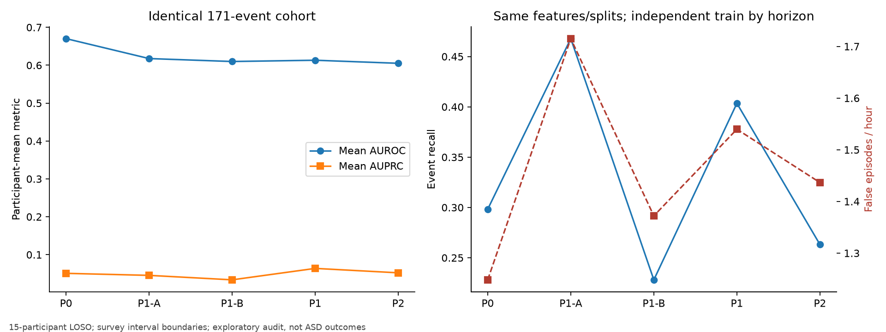
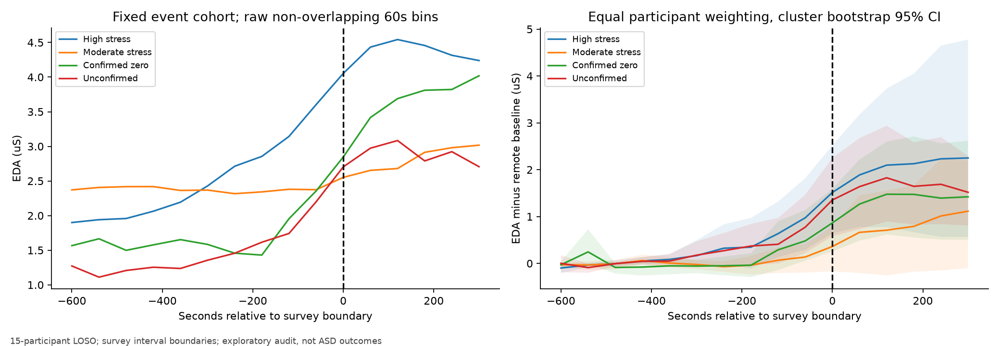
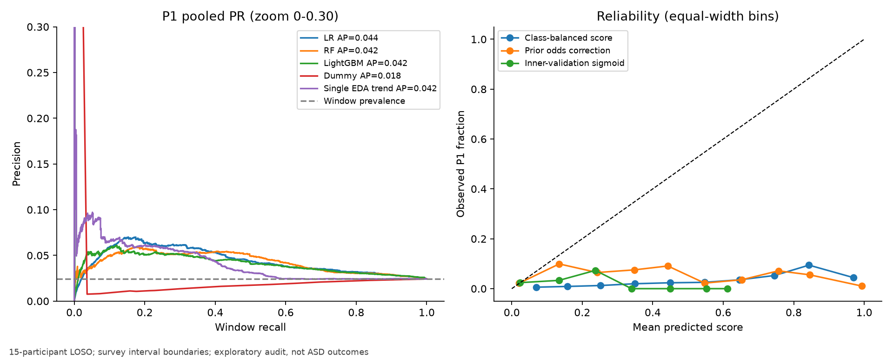
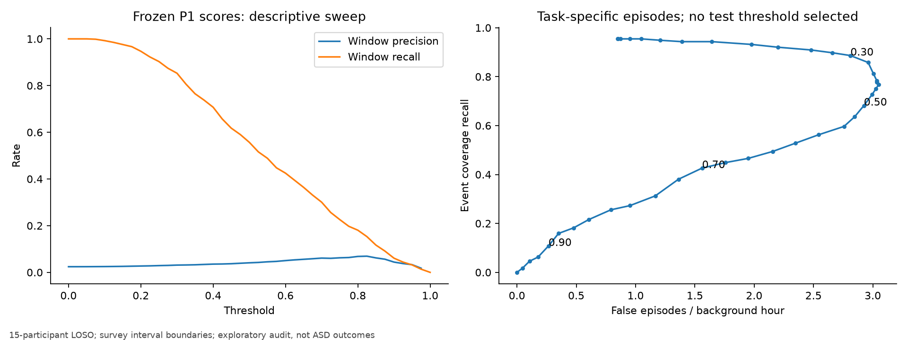
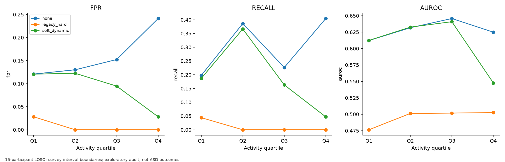
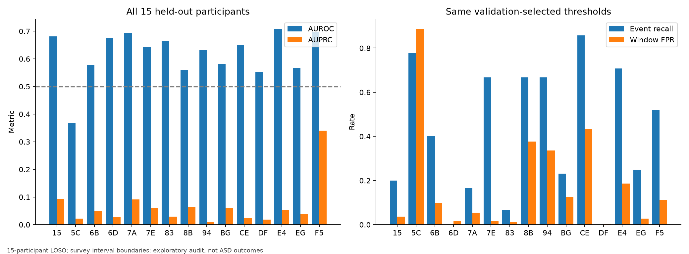
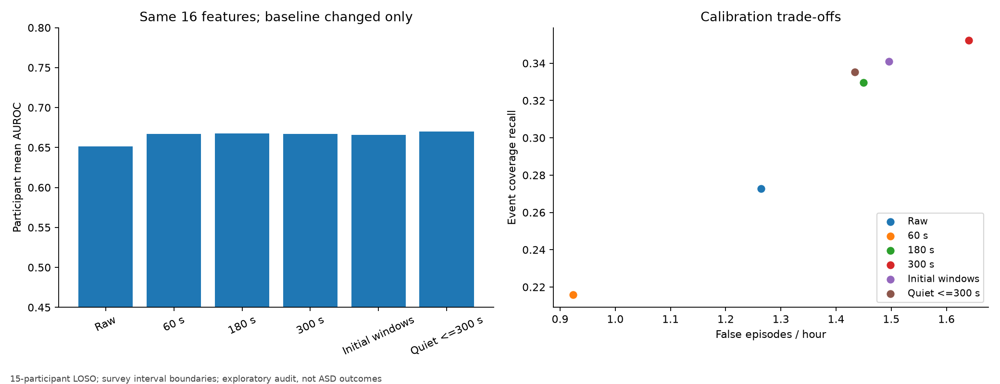
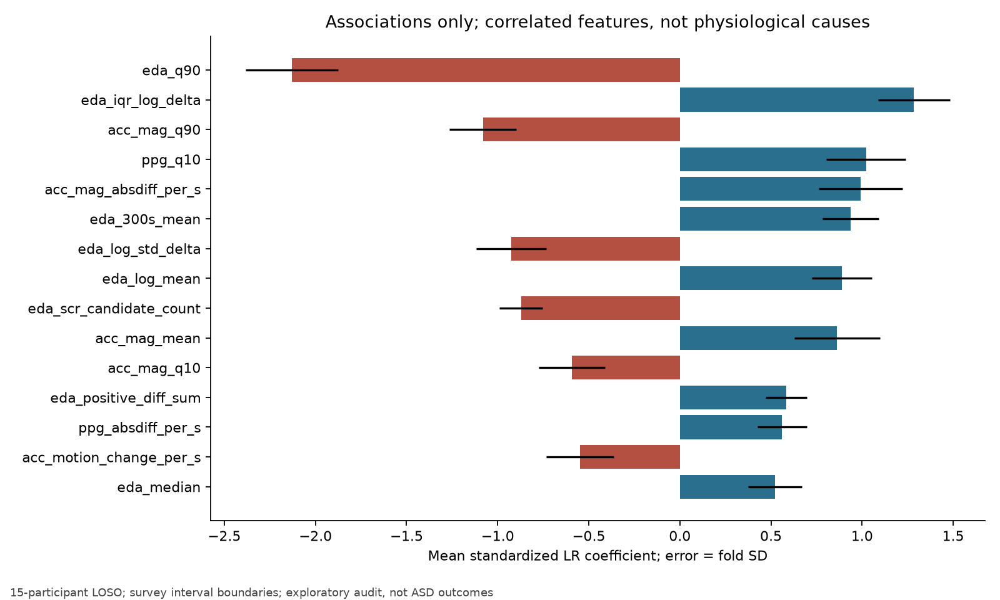
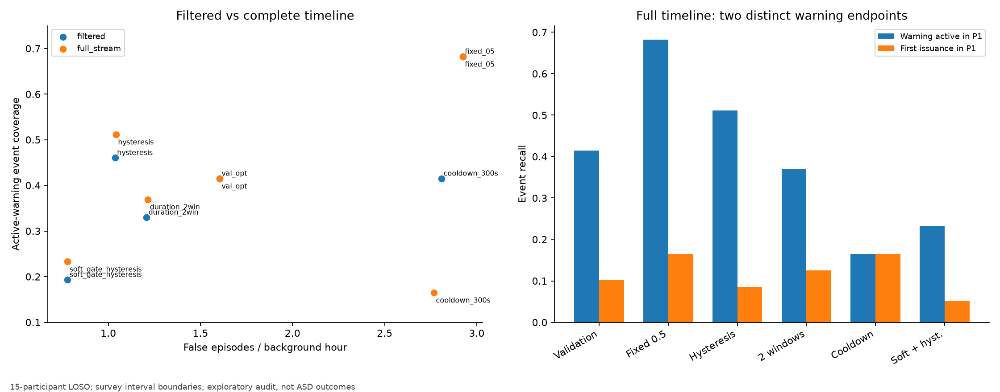

# Nurses P1 성능 저하 원인 정밀 감사

작성일: 2026-10-26 (한국시간). 대상: 성인 간호사 15명의 회고 설문으로 확인한 스트레스 **구간 경계** 예측. 자폐 멜트다운 예측으로 해석하지 않는다.

## 0. 핵심 판정과 해석 기준

현재 자료는 제한적인 P1 분류 신호를 보이지만, **독립적으로 관찰한 실제 스트레스 시작을 60~180초 전에 안정적으로 알린다는 근거는 부족하다.** 가장 큰 제약은 알고리즘에서 유래한 사건 경계와 미검증 음성, 사건 가까이에서만 뚜렷해지는 생리 변화, 운동과 스트레스의 중첩, 심한 불균형, 개인차다. 별도로 보정·평가·보고 오류도 발견했다. 이 오류를 수정했다고 높은 P1 성능이 회복되지는 않았다.

`CONFIRMED`는 이 자료에서 통제 변경의 효과 또는 구현상의 오류가 확인됐다는 뜻이다. `SUPPORTED`는 정량적 연관은 있으나 생리적/통계적 인과 기여율이 확정되지 않았다는 뜻이다. `HYPOTHESIS`는 미검증, `RULED OUT`은 검사한 범위에서 지배 원인으로 보기 어렵다는 뜻이다. 원인별 효과는 겹치므로 합산해 “성능 저하의 몇 %”로 제시하지 않는다. 33개 설정의 탐색적 감사이며, 신뢰구간은 다중 비교를 보정한 확증 검정이 아니다.

### 성능 저하 원인 TOP 5

| 순위 | 원인과 수준 | 핵심 증거와 정량적 영향 | 확신의 범위 |
|---|---|---|---|
| 1 | 라벨의 독립성 및 음성 신뢰성 한계 — **SUPPORTED** | 동일 13명·동일 617양성·동일 점수에서 미검증 배경 대비 AUROC 0.6478, 설문 확인 0 대비 0.5026. 사건은 생리 알고리즘 후보를 사후 확인한 경계다. | 구조적 한계는 확인. 실제 배경 오라벨 수나 그로 인한 손실은 미확정. |
| 2 | 충분히 이른 스트레스 특이 신호가 약함 — **SUPPORTED** | 공통 171사건에서 P0 평균 AUROC 0.6702, P1 0.6132. 차이 +0.0571, 참가자 bootstrap 95% CI [0.0158,0.1003]. | 이 자료의 구간 비교에 대한 근거. 실제 심리적 onset 시점은 모름. |
| 3 | 활동과 스트레스 동반 발생, 운동 게이트의 진양성 억제 — **CONFIRMED** | 기존 LR 고정 점수에서 Q4 FPR 23.94%→2.78%와 함께 사건 71→40, 즉 31건 추가 미탐. | 게이트의 직접 영향은 확인. 운동→스트레스라는 인과 주장은 하지 않음. |
| 4 | 낮은 기저율과 점수 보정·임계값 불일치 — **CONFIRMED** | 양성 2.42%, 시간 가중 시 1.40%. 주 LR 창 Precision 4.73%. 무가중 LR의 제한 임계값 격자는 사건 4.55%, 적절한 검증 격자는 36.93%로 바뀌지만 AUROC는 동일. | 경보/확률 해석 문제는 확인. 불균형만으로 낮은 AUROC를 설명할 수 없음. |
| 5 | 개인 분포 차이와 중복된 특징 표현 — **SUPPORTED** | 5C AUROC 0.3673/FPR 88.73%. 동일 기준선에서 62→16특징은 평균 AUROC +0.0492, CI [0.0012,0.1009], 그러나 사건 Recall 41.48%→34.09%. | 특징 압축 효과는 통제 확인. 개인차의 독립적인 총 기여율은 미확정. |

별도의 가장 중요한 **평가 해석 오류**: 전체 시간축 히스테리시스에서 “P1 중 경고가 활성”은 90/176(51.14%)지만 “P1에 에피소드 최초 발령”은 15/176(8.52%)다. 이 차이는 AUROC 저하 원인은 아니며, 기존 사건 탐지율을 실제 신규 사전 알림 성능으로 해석하지 못하게 한다.

## 1. 기존 성능 재현과 수치 정합성

### 1.1 저장된 결과로 정확히 재현

`features.csv` 51,234창, P1 QC 통과 평가 창 27,250개, 양성 659개(2.4183%), 참가자 15명, 기존 적격 사건 176건을 확인했다. 기존 `predictions.csv`는 4모델×27,250=109,000행이다. 원래 평가 함수를 그대로 호출한 결과:

| 지표 | 저장 결과 재계산 | 판정 |
|---|---:|---|
| LR 참가자 평균 AUROC | 0.616658 | 요청한 0.6167 재현 |
| LR 참가자 평균 AUPRC(AP) | 0.065345 | 0.0653 재현 |
| LR Pooled AUROC | **0.663674** | 0.6415가 아님 |
| LR 참가자 중앙값 AUROC | **0.641534** | 0.6415의 실제 출처 |
| LR Pooled AUPRC | 0.043940 | 창 기저율 0.024183 대비 약 1.82배 |
| LR 사건 탐지율 | 71/176 = 40.3409% | 재현 |
| LR 오경보 | 612/390.35h = 1.567824/h | 원 평가 정의로 재현 |
| LR 히스테리시스 탐지율 | 79/176 = 44.8864% | 원 평가 정의로 재현 |
| LR 히스테리시스 오경보 | 389/390.35h = 0.996542/h | 재현 |

원 평가의 LR 창 TP/FP/TN/FN은 **209/4257/22334/450**이다. 창 Pooled Recall은 31.71%, 참가자 평균 Recall은 28.38%, 사건 Recall은 40.34%로 서로 다른 지표다. 같은 사건의 여러 겹친 양성 창 중 하나만 경고해도 사건이 탐지되므로 사건 Recall이 창 Recall보다 높을 수 있다.

근거: [cached_model_reproduction.csv](../results/nurse_forecasting/root_cause_analysis/cached_model_reproduction.csv), [legacy_alert_policy_reproduction.csv](../results/nurse_forecasting/root_cause_analysis/legacy_alert_policy_reproduction.csv), `reproduced_legacy_LR.json`, 원 `model_comparison.csv`/`per_subject_metrics.csv`.

### 1.2 새 학습의 재현 오차를 별도로 기록

같은 코드·특징·분할·임계값 절차로 다시 적합한 결과는 기존 저장 확률과 완전히 같지 않았다. 최대 확률 차이 0.01019, 27,250창 중 판정 차이 8개, 임계값 차이 0이다. 평균 AUROC는 0.616733으로 차이가 약 0.000075다. 이를 정확히 동일한 재학습이라고 표현하지 않는다. 저장된 예측값의 지표 재계산은 정확히 재현했고, 원인 비교는 새 실험 사이에서 수행했다. 스레드 수까지 맞춘 재현 LR은 AUROC 0.616693, 라벨 비참조 LR은 0.616765다. 보정 수정 효과는 +0.000072, CI [-0.000212,0.000368]이다. 잔여 수치 차이가 라이브러리/BLAS/최적화 중 어디에서 발생했는지는 분해하지 못했다.

### 1.3 기존 문서에서 발견한 불일치

저장된 실제 상태별 창 수는 다음과 같다. 이전 보고서의 진행 중 8,622/회복기 2,250/미확인 10,602 등의 표와 다르다. 실제 CSV를 기준으로 분석했다.

| state | windows | qc_valid |
| --- | --- | --- |
| CONFIRMED_NO_STRESS_0 | 2173 | 2173 |
| ONGOING_STRESS_EVENT | 9608 | 9608 |
| POST_EVENT_REFRACTORY | 3947 | 3923 |
| PRE_ONSET_BUFFER_300_600S | 1261 | 1260 |
| PRE_ONSET_P0_0_60S | 332 | 332 |
| PRE_ONSET_P1_60_180S | 659 | 659 |
| PRE_ONSET_P2_180_300S | 626 | 626 |
| UNKNOWN_NA_CENSORED | 8149 | 8140 |
| VERIFIED_NON_EVENT | 24479 | 24418 |

매니페스트의 총 기록 시간은 1,251.6579h, 주석 세션은 603.9961h다. 세션 중첩은 **BG에서 1건, 1,499초**이며 기존 문서의 “0건”과 다르다. 특징 캐시에 같은 참가자·같은 예측 timestamp 중복은 0건이다. 구간 중첩과 완전히 같은 특징 행의 중복은 구분했다.

## 2. 데이터·라벨 신뢰성 감사

### 2.1 사건 시작 시각의 생성과 반올림 추적

원본 Excel ZIP/XML을 직접 읽었다. 실제 워크북은 `in` 시트 1개이며, 유효 행 358개, 시작/종료 시각은 모두 초 성분 0, 수식 셀은 0개다. Excel 일수/시각 값 자체가 분 단위다. 로컬 파서는 `time×86400`을 가장 가까운 **초**로 반올림해 부동소수점 잔차를 제거할 뿐, 분 단위 시각을 생성하지 않는다. 최대 잔차는 약 1.46e-11초였다.

따라서 **분 단위 기록은 확인했지만, 실제 사건을 최근접 분으로 반올림했는지, 버림/올림했는지, 수기 수정했는지와 실제 오차 분포는 확인하지 못했다.** ±30/±60초는 감사 가정이며 관측된 오차나 보정값이 아니다. 기존 문서의 “±60초로 반올림됨”은 입증 범위를 넘는다.

[원논문](https://www.nature.com/articles/s41597-022-01361-y)은 EDA·HR·피부온도 특징의 RF 출력과 변화점 분할로 후보를 만든 뒤, 교대 종료 시 설문으로 확인했다고 설명한다. 긴 후보 최대 6개를 제시했고, 미탐 사건의 추가 보고나 버튼 표시는 받지 못했다고 명시한다. `na`는 미확인 후보이며, 0/1/2만 확인됐다. 배경 전체의 무스트레스 여부는 검증되지 않았다. 그러므로 현재 `VERIFIED_NON_EVENT`라는 이름은 실제 확인 수준을 과장한다.

[공개 원저자 노트북](https://github.com/CPHSLab/Stress-Detection-in-Nurses/blob/main/predictor.ipynb)의 소스 셀도 확보했다(blob SHA `f542cc4a589f37c3eda9db47b9cffadf574dd094`). 10초 창/5초 간격, 과거 특징, RF, 이동 평균, offline 변화점 분할, 초 단위 문자열 출력은 확인되지만 Excel로의 최종 분 단위 변환 코드는 없다. 또 공개 예제의 `pd.read_csv(..., nrows=1)` 후 `gt.iloc[0,0]`은 배포 원본에 적용하면 epoch 대신 표본률 **4.0**을 읽는다. 원본 첫 행 epoch 1594213322.0과 다르다. 이는 공개 예제의 재현 결함이며, 이 코드가 실제 358행 설문 생성에 그대로 쓰였다는 증거는 아니다. **이 예제만으로 설문 시각을 이동시키지 않았다.**

근거: [survey_values.csv](../results/nurse_forecasting/root_cause_analysis/survey_values.csv), `survey_structure.json`, `sources/upstream_predictor_source.py:60-63,186,198-265`, `upstream_reference_time_reproduction.json`.

### 2.2 알고리즘 후보와 라벨의 의존성

모델 입력과 사건 생성이 일부 같은 센서에 의존한다. 생리 변화가 경계 전부터 보인다는 사실만으로 독립적 심리 사건의 전조를 입증할 수 없다. 사후 설문은 후보의 인지적 스트레스 수준을 확인했으나 초 단위 onset의 독립 관측은 제공하지 않는다. 후보 생성/긴 구간 선택으로 사건 표집도 편향될 수 있다. 이 구조는 확인했지만 그로 인한 AUROC 손실/상승량은 이 자료만으로 인과적으로 추정할 수 없다.

같은 모델 점수를 고정하고, 양성 및 참가자를 동일하게 유지한 13명 대조:

| experiment | n | positive | macro_auroc | pooled_auroc | pooled_fpr |
| --- | --- | --- | --- | --- | --- |
| confirmed_zero | 2790 | 617 | 0.5026 | 0.5951 | 0.3231 |
| unverified_background | 22887 | 617 | 0.6478 | 0.6768 | 0.1301 |

13명은 두 음성 출처와 양성을 모두 가진 공통 집합이다. 전체 15명 표도 [negative_label_source_control.csv](../results/nurse_forecasting/root_cause_analysis/negative_label_source_control.csv)에 보존했다. CE·EG는 확인 0 음성이 없어 해당 AUROC가 정의되지 않는다. 이를 좋은 참가자 선별로 대체하지 않았다. 양성의 **사전 구간**과 확인 0의 **후보 진행 구간**을 비교하므로 시간상 같은 단계끼리의 대조는 아니다. 이 비교는 스트레스 특이성이 약하다는 근거이며 음성의 참오류율을 측정한 것은 아니다.

QC 통과 음성 26,591개 중 확인 0은 2,173개, 미검증 배경은 24,418개(**91.83%**)다. 확인 0만 써서 다시 학습한 통제는 평균 AUROC 0.6486, Pooled 0.6235를 보였지만 양성 비율이 23.27%로 달라져 AP·Precision·FA/h를 원 코호트와 직접 비교할 수 없다. 이는 다른 표집 조건의 연구이며 기존 P1 개선 수치가 아니다.

### 2.3 ±30초·±60초 시각 오차 민감도와 보수적 평가

새 라벨 비참조 LR을 고정하고, 원 51,234개 예측 시각·센서 특징·fold 임계값을 고정했다. 모든 설문 구간의 시작/끝을 함께 -60/-30/0/+30/+60초 이동한 가정을 각각 재라벨링했다. 기존 176사건 분모를 유지했다. 실제 시각의 교정이나 점수가 좋은 이동량 선택은 하지 않았다.

| experiment | positive | macro_auroc | macro_auprc | pooled_auroc | event_recall | fa_hr |
| --- | --- | --- | --- | --- | --- | --- |
| frozen_offset_-60s | 649 | 0.6071 | 0.0569 | 0.6369 | 0.3807 | 1.6001 |
| frozen_offset_-30s | 655 | 0.6145 | 0.0619 | 0.6519 | 0.4091 | 1.5945 |
| frozen_offset_+0s | 659 | 0.6168 | 0.0654 | 0.6638 | 0.4148 | 1.6042 |
| frozen_offset_+30s | 662 | 0.6206 | 0.0689 | 0.6717 | 0.4091 | 1.6146 |
| frozen_offset_+60s | 662 | 0.6281 | 0.0723 | 0.6787 | 0.4318 | 1.6209 |

| offset_s | changed_labels_all | lost_original_positives | new_positives | changed_to_direct_negative |
| --- | --- | --- | --- | --- |
| -60 | 1360 | 332 | 322 | 0 |
| -30 | 682 | 166 | 162 | 0 |
| 0 | 0 | 0 | 0 | 0 |
| 30 | 685 | 163 | 166 | 0 |
| 60 | 1276 | 329 | 332 | 0 |

±30초에서 기존 양성 163~166창(약 25%), ±60초에서 329~332창(약 50%)이 P1에서 빠진다. 원 양성이 직접 음성으로 뒤집힌 경우는 0개로, 주로 다른 예측 구간/검열로 바뀐다. 성능 변동은 있으나 이 가정만으로 높은 구분력이 회복되지 않는다.

불확실성 전체 범위에서 라벨이 동일한 창만 남긴 보수적 평가:

| experiment | n | positive | macro_auroc | macro_auprc | event_recall |
| --- | --- | --- | --- | --- | --- |
| stable_plusminus30 | 26567 | 330 | 0.6195 | 0.0424 | 0.3295 |
| stable_plusminus60 | 25986 | 0 | 정의 불가 | 정의 불가 | 정의 불가 |

±30초에서는 90~150초 내부의 양성 330창만 남아 AUROC 0.6195/AP 0.0424, 58/176 탐지다. 남긴 구간이 좁아져 AP·사건 Recall은 직접 개선 비교가 아니다. ±60초에서는 폭 120초인 P1의 모든 오차 가정에 공통으로 속하는 양성 창이 **0개**여서 AUROC/AP를 산출할 수 없다. 이를 0점 또는 모델 실패로 채우지 않았다.

### 2.4 사건 직전·직후, 중복, 세션과 결측

캐시의 `state`, `target_event_id`, P0/P1/P2 라벨을 현 코드로 51,234행 재생성한 불일치는 모두 0개였다. P1은 실제 구현상 **60 < lead ≤ 180초**다. 현재 확인 사건 진행 구간에 P1 음성으로 들어간 창은 0개이며, 확인 사건 종료 후 900초 회복기와 `na` 주변 -300~+600초도 검열된다. 미래 다른 구간을 P1 음성으로 잘못 넣은 단순 경계 버그는 찾지 못했다. 그러나 사전 구간이 이전 사건의 회복기보다 우선해 포함되는 규칙이 있다.

설문 완전 중복은 3쌍이며 이 중 스트레스 2쌍(7A·F5), `na` 1쌍(15)이다. 시작 시각 중복 행은 6개다. 원 적격 P1 사건 중 10개에는 그 event_id로 배정된 양성 창이 없고, 시간 구간 자체에 사용 가능한 평가 창이 없는 사건은 8개다. 중복 사건은 같은 시간 창을 공유할 수 있어 두 수가 다르다.

| denominator | n_events | detected_events | event_recall |
| --- | --- | --- | --- |
| original176 | 176 | 73 | 0.4148 |
| original176_observable | 168 | 73 | 0.4345 |
| exact_interval_deduplicated | 174 | 72 | 0.4138 |
| exact_interval_deduplicated_observable | 166 | 72 | 0.4337 |

분모 축소는 모델 개선이 아니다. 엄격한 중복 제거와 관측 가능성 조건을 함께 적용하면 174건 중 166건이 관측 가능하며 탐지는 72건이다. 원 사건 분모를 유지한 결과도 함께 제시했다.

현재 P1 양성의 180초 주 창이 이전 사건 진행 신호와 겹친 경우는 0창, 300초 보조 창은 4창이다. 이전 사건 진행 및 종료 후 900초까지 입력 이력 전체가 겹치지 않게 제외하고 다시 학습한 결과는 평균 AUROC 0.5867/AP 0.0580이었다(평가 창 26,634/양성 576). 이 제외만으로 성능이 회복되지 않았고, 코호트가 달라져 효과 크기를 원 전체 성능 손실로 해석하지 않는다. 적격 사건/회복기/다른 사건이 인접한 모든 행은 [event_neighborhood_audit.csv](../results/nurse_forecasting/root_cause_analysis/event_neighborhood_audit.csv)와 [label_interval_contamination.csv](../results/nurse_forecasting/root_cause_analysis/label_interval_contamination.csv)에 남겼다.

QC 제외는 95/51,234창, P1 음성 61개·양성 0개다. 입력 62특징의 NaN 비율은 0이나 IBI 유효 플래그가 0인 창은 27.85%, 원본 IBI 파일이 빈 세션은 125/609개였다. 유한값/낮은 EDA/평탄 신호 검사는 운동성 아티팩트나 실제 센서 접촉의 완전한 검증이 아니다. 균일 샘플 파일만으로 값이 유한한 패킷 손실·시계 드리프트까지 배제하지 못한다.

### 2.5 시간축 동기화

609개 원본 ZIP의 EDA/BVP/ACC/TEMP 헤더 시작 시각은 모두 일치했다. HR은 모든 세션에서 정확히 +10초이며 특징 코드가 이 offset을 반영한다. 기존 매니페스트의 주 센서 종료 길이 최대 차이는 3.015625초다. 센서 사이 상대 시간축과 설문-센서의 절대 onset 정확도는 별개다.

| mode | overlap_events | onset_covered | overlap_hours |
| --- | --- | --- | --- |
| America/Chicago | 323 | 308 | 154.8621 |
| UTC | 88 | 65 | 31.4171 |
| fixed_CST_UTCminus6 | 264 | 249 | 121.7060 |
| offset_minus3600 | 238 | 182 | 112.4060 |
| offset_minus60 | 323 | 310 | 154.6782 |
| offset_plus3600 | 255 | 239 | 114.5343 |
| offset_plus60 | 323 | 321 | 154.9485 |

Chicago 현지 시간 변환은 323/358구간이 센서와 겹치며 고정 UTC-6은 264개, UTC 직접 해석은 88개다. 이는 DST를 적용한 현지 시간 해석을 지지한다. 원논문의 CST 표기만으로 연중 고정 -6을 적용하면 정합성이 악화된다. 다만 +60초 가정은 onset 커버 수를 늘리기도 하므로 **겹침 최대화만으로 초 단위 정답이나 시계 오차를 확정하지 않았다.** 미매칭 35구간이 모두 비착용/통신 종료 때문이라는 기존 주장은 자료로 확인되지 않았다.

### 2.6 누수 감사와 수정 실험

| 경로 | 확인 결과 | 영향/조치 |
|---|---|---|
| LOSO 및 내부 검증 | 모든 fold에서 테스트 참가자가 train/validation에 없고 train/validation 참가자 겹침 0 | 기본 참가자 분리는 적절 |
| 결측 대체·정규화 | Pipeline을 train 또는 14명 dev에서만 fit | 테스트 통계로 fit한 흔적 없음 |
| 개인 기준선 | `calibration.py`가 `state != ONGOING_STRESS_EVENT`로 기준선 후보 선택 | **라벨 누수 확인**. 4세션 420창, P1 평가 42창의 특징 변경 |
| 기준선 수정 효과 | 같은 첫 창 수·활동 기준을 유지하고 state 참조만 제거 | AUROC +0.000072로 매우 작음. 큰 저성능 원인 아님 |
| 특징의 미래 신호 | 214세션 첫 창 원본 재계산 최대 상대오차 3.1e-16, 미래 변조 영향 0 | 현재 사건 후 샘플의 직접 입력은 검사 범위에서 발견 안 됨 |
| 관측 길이 명세 | 주 창 180초 외에 60/300초 보조 특징을 사용 | “과거 180초만 사용”이라는 문서 표현은 부정확 |
| 시각 격자 | 사건 주변 30초/배경 60초를 실제 설문 시각으로 정함 | 평가 표집이 미래 라벨에 의존. 새 실시간 고정 격자 검증 필요 |
| 임계값 | 내부 검증 참가자의 F1만 사용 | 테스트 라벨로 새 임계값을 선택하지 않음 |
| 모델/정책 선택 | 기존 최종 보고서가 모든 LOSO 결과를 비교하여 주 모델/정책 선택 | 선택까지 감싼 nested 외부 검증은 아님. 최종 선택의 새 참가자 성능은 미검증 |
| 기존 타임라인 그림 | runner가 `final_lr_pipe`(15명 전체 refit)로 점수를 산출하면서 held-out 표기 | **그림의 일반화 근거 오류**. 핵심 OOF CSV 지표와 분리 |

원래 코드와 모델은 덮어쓰지 않았다. 수정된 기준선·시간 노출·사건 일치·연속 정책 재생은 새 감사 스크립트와 OOF 점수 파일에 구현했다. 원본용 수정 배포를 완료한 것으로 표현하지 않는다.

## 3. 시간 구간별 예측 가능성

각 구간은 동일 LR C=0.25, 동일 62특징, 라벨 비참조 기준선, 동일 외부/내부 참가자 분할 및 임계값 절차다. 구간별 양성 비율이 다르므로 AP와 사건 Recall은 AUROC와 함께 해석한다. 원 적격 사건이 다른 문제를 피하기 위해 공통 **171사건**으로 학습 양성과 평가 사건을 맞춘 주 비교:

| task | positive | macro_auroc | macro_auprc | pooled_auroc | pooled_auprc | event_recall | fa_hr |
| --- | --- | --- | --- | --- | --- | --- | --- |
| P0 | 324 | 0.6702 | 0.0507 | 0.6803 | 0.0262 | 0.2982 | 1.2483 |
| P1-A | 324 | 0.6176 | 0.0454 | 0.6697 | 0.0233 | 0.4678 | 1.7151 |
| P1-B | 322 | 0.6098 | 0.0336 | 0.6426 | 0.0197 | 0.2281 | 1.3721 |
| P1 | 646 | 0.6132 | 0.0638 | 0.6583 | 0.0427 | 0.4035 | 1.5397 |
| P2 | 626 | 0.6051 | 0.0521 | 0.6074 | 0.0336 | 0.2632 | 1.4366 |

P0-P1 차이는 +0.0571이고 참가자 paired bootstrap CI가 [0.0158,0.1003]이다. 반면 P1-A와 P1-B 차이 +0.0078의 CI [-0.0223,0.0350], P2-P1 차이 -0.0081의 CI [-0.0432,0.0264]는 0을 포함한다. **60~120초가 120~180초보다 확실히 우수하다거나 “정확히 몇 초부터 예측 가능하다”고 결론 내리지 않는다.** 독립 학습 없이 같은 P1 점수로 모든 시간대를 평가한 [fixed_model_horizon_comparison.csv](../results/nurse_forecasting/root_cause_analysis/fixed_model_horizon_comparison.csv)도 별도로 보존했다.

원본 EDA는 사건별 -600~+360초 전체가 관측된 동일 사건 집합에서, 서로 겹치지 않는 60초 구간으로 분석했다. 중복 구간을 제거하고 참가자별 평균 변화에 bootstrap을 적용했다. 고스트레스 140사건/15명에서 -180~-120초 EDA 변화는 원격 기준 대비 +0.347uS, CI [-0.112,0.971]였고, -60~0초는 +0.974uS, CI [0.293,1.819]였다. 확인 0의 33사건/13명에서도 -60~0초 +0.480uS, CI [0.059,1.139]가 나타났다. 강한 근접 상승은 스트레스 특이 반응이라기보다 후보 생성 구조와도 양립한다. 이 60초 bin 분석으로 순간적인 시작 시각을 결정할 수 없다.

현재 사건 이후 정보를 P1 입력에 넣지 않았다. 사건 이후 원신호는 라벨 의존성을 확인하는 **기술적 궤적 분석**에만 사용했고 학습 특징/임계값/모델 선택에 넣지 않았다.




## 4. 클래스 불균형, 평가 집계와 확률 문제

### 4.1 같은 특징·분할에서 모델 비교

아래 새 실험은 오류를 제거한 같은 기준선으로 비교했다. 단순 생리 기준선은 단일 EDA 변화 또는 단일 HR 변화만을 사용하는 1변수 LR이며, 방향/스케일/임계값을 테스트 데이터에서 맞추지 않았다. Dummy는 개발 참가자의 사전 양성률을 쓴다.

| experiment | macro_auroc | macro_auprc | pooled_auroc | pooled_auprc | event_recall | fa_hr | pooled_precision | pooled_recall |
| --- | --- | --- | --- | --- | --- | --- | --- | --- |
| model_Dummy | 0.5000 | 0.0266 | 0.3529 | 0.0176 | 0.0000 | 0.0000 | 정의 불가 | 0.0000 |
| simple_eda_slope | 0.5412 | 0.0587 | 0.5693 | 0.0423 | 0.4091 | 2.5069 | 0.0585 | 0.2777 |
| simple_hr_change | 0.4962 | 0.0327 | 0.5066 | 0.0249 | 0.6761 | 2.6488 | 0.0247 | 0.5857 |
| labelblind_same_method | 0.6168 | 0.0654 | 0.6638 | 0.0440 | 0.4148 | 1.6042 | 0.0473 | 0.3217 |
| model_RF | 0.6392 | 0.0754 | 0.6628 | 0.0425 | 0.4602 | 1.9705 | 0.0432 | 0.3961 |
| model_LightGBM | 0.6228 | 0.0741 | 0.6523 | 0.0418 | 0.5625 | 2.2077 | 0.0422 | 0.4476 |

RF-LR 평균 AUROC 차이 +0.0224의 CI [-0.0175,0.0664], LightGBM-LR +0.0061의 CI [-0.0388,0.0543]다. 검사한 고정 모델에서 단순 용량 증대가 핵심 병목을 해결한다는 근거가 없다. 기존 모델 비교 CSV의 RF/LGBM 수치도 별도 보존했으며, 보정 수정 후 학습 결과와 섞어 동일 실행으로 쓰지 않았다.

### 4.2 Pooled 0.6415라는 값이 왜 잘못됐는가

0.6415는 **참가자별 AUROC의 중앙값**이다. 실제 pooled 0.6637과 mean 0.6167 차이는 집계 가중치와 참가자간 점수 비교에서 발생한다. 전체 양성-음성 쌍을 참가자별로 분해한 결과:

| within_subject | pair_fraction | pair_auc |
| --- | --- | --- |
| False | 0.9206 | 0.6639 |
| True | 0.0794 | 0.6613 |

Pooled 쌍의 92.06%는 서로 다른 참가자간 비교다. 참가자 내부 쌍만 가중 합산한 AUROC도 0.6613으로 균등 참가자 평균 0.6167과 다르다. 창·사건 수와 점수 분포가 큰 참가자에 더 많은 가중치가 주어지기 때문이다. 각 fold는 다른 모델/개발 사전률을 가지므로 pooled 점수의 비교 가능성도 제한된다. 주 결과는 15명 macro, pooled는 보조 결과로 유지한다.

Dummy는 각 참가자 안에서는 상수여서 AUROC 0.5지만 pooled에서는 0.3529다. held-out 참가자의 높은 양성 기여가 dev 사전률을 낮추는 leave-one-out 구조와 서로 다른 fold의 상수를 비교하는 효과다. 동일한 0.5 점수로 모두 고정한 통제는 pooled AUROC 0.5, AP 0.024183이다. Dummy pooled <0.5를 생리적 역예측 능력으로 해석하지 않는다.

### 4.3 불균형과 임계값을 분리한 통제

| experiment | macro_auroc | macro_auprc | event_recall | fa_hr | pooled_precision | pooled_recall |
| --- | --- | --- | --- | --- | --- | --- |
| labelblind_same_method | 0.6168 | 0.0654 | 0.4148 | 1.6042 | 0.0473 | 0.3217 |
| balanced_full_grid | 0.6168 | 0.0654 | 0.4205 | 1.5836 | 0.0472 | 0.3278 |
| unweighted_legacy_grid | 0.6317 | 0.0627 | 0.0455 | 0.0877 | 0.0310 | 0.0319 |
| unweighted_full_grid | 0.6317 | 0.0627 | 0.3693 | 1.7074 | 0.0407 | 0.3020 |

가중치 대조는 같은 넓은 검증 임계값 후보 집합에서 balanced와 unweighted를 비교한다. 임계값 대조는 같은 unweighted 점수를 고정한 채 원 제한 격자 [0.20,0.85]와 넓은 격자를 비교한다. 후자는 **AUROC가 0.631671로 동일**하면서 사건 Recall 4.55%→36.93%로 변한다. 이는 임계값 단위가 실제 낮은 사전률에 맞지 않을 때 발생하는 문제다. balanced/unweighted 대조의 AUROC 차이 +0.0149 CI [-0.0004,0.0301]은 확정적이지 않다. 어떤 경우도 테스트 라벨로 최적 임계값을 선택하지 않았다.

새 주 LR의 양성률 0.02418, 창 Recall 0.32170, FPR 0.16062를 PPV 식에 넣으면 `π×TPR / (π×TPR+(1-π)×FPR)` = **0.04729**다. 높은 음성 수 때문에 적당한 FPR도 양성 경고를 압도한다. 창 Precision과 경보 에피소드 Precision 약 0.10375는 각각 다른 분모다.




41개 임계값의 PR/사건 Recall–FA/h 곡선은 진단용 test sweep이다. 그래프에서 유리한 점을 골라 최종 성능으로 보고하거나 저장하지 않았다. 임계값을 낮춰 경고가 매우 길게 이어지면 180초 병합 규칙 때문에 FA 에피소드 수가 오히려 줄 수 있다. FA/h 곡선의 비단조성을 실용적 개선으로 간주하지 않는다.

### 4.4 확률 보정과 중첩 표본 의존성

balanced LR의 평균 출력은 0.4221인데 실제 양성률은 0.02418이다. 따라서 원 점수를 그대로 “미래 스트레스 발생 확률 42%”라고 쓰면 잘못이다. 개발 사전률 odds 보정과 내부 검증 참가자만으로 fit한 sigmoid를 검사했다.

| probability | mean_probability | pooled_brier | pooled_auroc | pooled_auprc |
| --- | --- | --- | --- | --- |
| prob | 0.4221 | 0.2229 | 0.6638 | 0.0440 |
| prob_prior_corrected | 0.0437 | 0.0395 | 0.6584 | 0.0431 |
| prob_sigmoid | 0.0257 | 0.0240 | 0.5605 | 0.0346 |

sigmoid는 Brier를 줄였지만 pooled AUROC/AP도 악화했다. 사전률 상수 예측의 Brier 약 0.02360과 비슷하거나 더 나쁘므로, 낮은 Brier만으로 유용한 예측을 주장하지 않는다. prior odds는 참가자 내부에서 단조 변환이라 순위를 바꾸지 않지만 fold별 변환이 달라 pooled 순위는 바뀔 수 있다. sigmoid는 일부 내부 검증에서 방향을 반대로 학습할 수도 있다. 내부 검증의 보정기를 14명 refit 모델에 적용하는 점수 이동도 한계로 남는다.

30초 간격과 180/300초 관측 창은 서로 강하게 겹친다. 창 27,250개를 독립 표본으로 간주하지 않고 **참가자 15명**을 재표집 단위로 5,000회 bootstrap했다. 주 LR macro AUROC CI [0.5705,0.6549], macro AP [0.0367,0.1094], cohort 사건 Recall CI [0.2672,0.5691], FA/h CI [0.9854,2.3766]이다. 임계값/학습 불확실성까지 재학습한 nested bootstrap은 아니다.

세션 시작에 고정된 격자의 일부만 남긴 180초 간격 평가에서는 n=5,418/양성 101, AUROC 0.5978이었다. 300초 간격에서는 양성 58개여서 더 불안정하다. 이 thinning은 원 캐시의 서로 다른 30/60초 위상 때문에 완전한 균일 격자 재생을 대체하지 못한다.

| experiment | window_prevalence | time_weighted_prevalence | time_weighted_macro_auroc | time_weighted_pooled_auprc | positive_mean_step_s | negative_mean_step_s |
| --- | --- | --- | --- | --- | --- | --- |
| labelblind_same_method | 0.0242 | 0.0140 | 0.6216 | 0.0267 | 30.0000 | 52.4920 |
| time_weighted_LR | 0.0242 | 0.0140 | 0.6208 | 0.0268 | 30.0000 | 52.4920 |

사건 주변 표집을 시간으로 가중하면 양성률은 2.42%→1.40%, 주 LR의 pooled AP는 0.04396→0.02666이다. 같은 노출 가중치를 학습·검증에 적용한 LR도 큰 구분력 회복은 없었다. 따라서 창 기저율과 AP는 라벨 의존 표집의 영향을 받는다. 실제 고정 30/60초 시간축에서 빠진 특징을 원신호로 추가 추출하는 완전한 prospective replay가 후속으로 필요하다.

## 5. 운동 교란과 게이트 손실

기존 모델의 고정 예측값/원 임계값으로 재생한 값:

| gate | q4_negative_fpr | n_detected_events | event_recall | false_alarms_per_hour |
| --- | --- | --- | --- | --- |
| none | 0.2394 | 71 | 0.4034 | 1.5678 |
| legacy_hard | 0.0000 | 1 | 0.0057 | 0.0589 |
| soft_dynamic | 0.0278 | 40 | 0.2273 | 1.0811 |

요청한 고활동 FPR 23.94%→2.78%, 사건 Recall 40.34%→22.73%가 재현됐다. hard gate는 1/176만 탐지해 대다수 신호를 제거한다. 새 라벨 비참조 모델의 같은 통제에서도 같은 방향이었다.

| gate | quartile | pos_windows | neg_windows | auroc | fpr | recall |
| --- | --- | --- | --- | --- | --- | --- |
| none | Q1 | 91 | 6722 | 0.6122 | 0.1208 | 0.1978 |
| none | Q2 | 101 | 6711 | 0.6317 | 0.1301 | 0.3861 |
| none | Q3 | 190 | 6622 | 0.6457 | 0.1524 | 0.2263 |
| none | Q4 | 277 | 6536 | 0.6249 | 0.2413 | 0.4043 |
| soft_dynamic | Q1 | 91 | 6722 | 0.6123 | 0.1206 | 0.1868 |
| soft_dynamic | Q2 | 101 | 6711 | 0.6326 | 0.1225 | 0.3663 |
| soft_dynamic | Q3 | 190 | 6622 | 0.6409 | 0.0947 | 0.1632 |
| soft_dynamic | Q4 | 277 | 6536 | 0.5476 | 0.0282 | 0.0469 |

새 모델에서 Q4 양성 277/659(42.03%)가 존재한다. Soft gate는 Q4 FP를 1,577→184로 줄이면서 TP도 112→13, Recall 40.43%→4.69%로 줄였다. `M(t)`가 큰 창에서는 점수 감쇠와 동적 임계값 상승이 동시에 일어나므로, 고활동 스트레스와 고활동 비사건을 함께 억제한다. ACC 단독 AUROC 0.6242도 이 자료에서 활동이 사건과 연관됨을 보인다. 원 코드는 soft gate를 “순위 보존”이라고 설명하지만 서로 다른 활동량의 창끼리는 감쇠율이 달라 실제 AUROC가 0.6168→0.5189로 떨어졌다.

참가자별 새 모델의 사건 손실:

| subject | none | soft_dynamic | lost_by_soft_gate |
| --- | --- | --- | --- |
| 15 | 2 | 1 | 1 |
| 5C | 7 | 7 | 0 |
| 6B | 4 | 1 | 3 |
| 6D | 0 | 0 | 0 |
| 7A | 5 | 1 | 4 |
| 7E | 2 | 0 | 2 |
| 83 | 1 | 1 | 0 |
| 8B | 8 | 4 | 4 |
| 94 | 4 | 1 | 3 |
| BG | 3 | 2 | 1 |
| CE | 6 | 6 | 0 |
| DF | 0 | 0 | 0 |
| E4 | 17 | 8 | 9 |
| EG | 1 | 0 | 1 |
| F5 | 13 | 8 | 5 |

E4에서 9건, F5에서 5건, 7A/8B에서 각각 4건을 추가로 놓쳤다. 추가 미탐 사건의 사전 활동 중앙값은 316.59이며 나머지는 168.34(가속도 원단위 변화/초)였다. 이 비교는 센서 활동 크기이며 검증된 운동 종목/강도 라벨이 아니다.

활동-EDA/HR/PPG 및 점수의 Spearman 상관은 참가자별·양성/음성별로 [motion_physiology_correlations.csv](../results/nurse_forecasting/root_cause_analysis/motion_physiology_correlations.csv)에, Q4 사건 대 비사건 생리 요약은 [high_motion_event_vs_background.csv](../results/nurse_forecasting/root_cause_analysis/high_motion_event_vs_background.csv)에 저장했다. 집계 상관은 개인별 기저선과 표집의 영향을 받으므로 운동이 원인이라는 인과 증거로 쓰지 않는다. 센서 제거 통제는 다음 절에서 동일 학습 조건으로 확인했다.



## 6. 개인차와 특징 표현

### 6.1 15명 전원 성능과 개인별 점수 편향

| subject | auroc | auprc | fpr | recall | n_events | detected_events | event_recall |
| --- | --- | --- | --- | --- | --- | --- | --- |
| 15 | 0.6812 | 0.0932 | 0.0362 | 0.1250 | 10 | 2 | 0.2000 |
| 5C | 0.3673 | 0.0222 | 0.8873 | 0.8750 | 9 | 7 | 0.7778 |
| 6B | 0.5785 | 0.0486 | 0.0982 | 0.2500 | 10 | 4 | 0.4000 |
| 6D | 0.6756 | 0.0265 | 0.0173 | 0.0000 | 2 | 0 | 0.0000 |
| 7A | 0.6934 | 0.0915 | 0.0538 | 0.1308 | 30 | 5 | 0.1667 |
| 7E | 0.6414 | 0.0601 | 0.0160 | 0.2500 | 3 | 2 | 0.6667 |
| 83 | 0.6657 | 0.0293 | 0.0123 | 0.0357 | 15 | 1 | 0.0667 |
| 8B | 0.5588 | 0.0633 | 0.3761 | 0.4468 | 12 | 8 | 0.6667 |
| 94 | 0.6325 | 0.0100 | 0.3367 | 0.5000 | 6 | 4 | 0.6667 |
| BG | 0.5822 | 0.0603 | 0.1263 | 0.1277 | 13 | 3 | 0.2308 |
| CE | 0.6496 | 0.0241 | 0.4329 | 0.6923 | 7 | 6 | 0.8571 |
| DF | 0.5532 | 0.0179 | 0.0026 | 0.0000 | 6 | 0 | 0.0000 |
| E4 | 0.7087 | 0.0542 | 0.1857 | 0.5435 | 24 | 17 | 0.7083 |
| EG | 0.5662 | 0.0388 | 0.0268 | 0.0625 | 4 | 1 | 0.2500 |
| F5 | 0.6970 | 0.3403 | 0.1127 | 0.4674 | 25 | 13 | 0.5200 |

같은 라벨 비참조 LR의 5C AUROC는 0.3673이며 FPR 88.73%, 반면 E4 AUROC 0.7087이다. 5C/8B의 음성 평균 점수는 약 0.582, CE는 0.221로 차이가 크다. 개인별 EDA·심박·활동량 중앙값, QC 제외율, IBI 결측률, 음성/양성 점수, 임계값 및 다른 14명 대비 표준화 평균 이동/Wasserstein 거리는 [corrected_subject_profiles.csv](../results/nurse_forecasting/root_cause_analysis/corrected_subject_profiles.csv), [subject_distribution_shift.csv](../results/nurse_forecasting/root_cause_analysis/subject_distribution_shift.csv)에 모두 남겼다.

EDA/활동량/결측률과 성능의 관계는 15명 Spearman 탐색으로 확인했다([participant_physiology_performance_correlations.csv](../results/nurse_forecasting/root_cause_analysis/participant_physiology_performance_correlations.csv)). 작은 표본, 다중 상관, 상호 연관된 센서 특성 때문에 고/저 성능을 단일 생리 요인으로 환원하지 않는다. IBI 무효율은 EG 77.34%, DF 13.65% 등으로 크게 다르나 결측률만으로 참가자 순위를 설명하지 못한다.

기존 결과에서 한 명씩 제외한 재집계 AUROC는 0.6101~0.6344로, 한 명만이 전체 신호를 만드는 것은 아니다. 반면 F5의 AP 0.34045를 빼면 macro AP는 0.06535→0.04569로 떨어져 AP 평균의 불안정성이 크다. 이는 영향 진단이며 보고에서 F5/5C를 제외한 최종 점수를 채택한 것이 아니다.



### 6.2 개인 보정의 올바른 통제

기존 `cal_1m`은 실제 60초 센서 기준선이 아니라 첫 **180초 특징 창**을 썼다. `cal_3m`은 첫 2개 창, `cal_5m`은 첫 4개 창을 사용하며 계산한 cutoff가 실제로 사용되지 않았다. 따라서 과거 “1/3/5분 보정” 비교는 정확한 초기 구간 길이 실험이 아니었다.

이번에는 원본에서 실제 첫 60/180/300초의 9개 보정용 관측량을 추출했다. 5분이 끝나기 전에는 이미 관측된 첫 180초 기준선만 쓰고, 300초가 지난 뒤 첫 300초 기준선으로 전환했다. 저활동 보정은 초기 300초 안에서 현재 시점까지 관측한 jerk≤38 창만 사용하고, 없으면 첫 창을 썼다. 모두 사건 라벨을 보지 않았다. 아래는 **같은 16특징·같은 분할·같은 모델**에서 보정만 바꾼 결과다.

| experiment | macro_auroc | macro_auprc | event_recall | fa_hr | pooled_precision |
| --- | --- | --- | --- | --- | --- |
| calibration_raw | 0.6512 | 0.0727 | 0.2727 | 1.2638 | 0.0418 |
| calibration_actual_60s | 0.6670 | 0.0755 | 0.2159 | 0.9233 | 0.0559 |
| calibration_actual_180s | 0.6675 | 0.0674 | 0.3295 | 1.4495 | 0.0439 |
| calibration_actual_300s | 0.6670 | 0.0670 | 0.3523 | 1.6403 | 0.0437 |
| calibration_labelblind_same_method | 0.6660 | 0.0665 | 0.3409 | 1.4959 | 0.0447 |
| calibration_quiet_initial300s | 0.6698 | 0.0668 | 0.3352 | 1.4340 | 0.0442 |

실제 60/180/300초 및 저활동 보정의 raw 대비 AUROC 차이는 약 +0.0158~+0.0186이나 모든 참가자 paired CI가 0을 포함한다. 1분이 3분보다 낫다거나 저활동이 최선이라는 결론은 내리지 않는다. 원 62특징 LR와 이 16특징 실험을 비교해 보정 하나의 개선으로 설명하지 않았다.



### 6.3 센서·특징군 ablation과 중요도

| experiment | macro_auroc | macro_auprc | event_recall | fa_hr |
| --- | --- | --- | --- | --- |
| sensor_eda | 0.6362 | 0.0697 | 0.2955 | 1.0162 |
| sensor_ppg | 0.5975 | 0.0424 | 0.5966 | 2.6075 |
| sensor_acc | 0.6242 | 0.0627 | 0.3920 | 1.9137 |
| sensor_eda_ppg | 0.6156 | 0.0651 | 0.4318 | 1.6997 |
| labelblind_same_method | 0.6168 | 0.0654 | 0.4148 | 1.6042 |

EDA 단독 0.6362, ACC 단독 0.6242, EDA+PPG 0.6156, ALL 0.6168이다. 많은 센서가 항상 더 좋은 구분력을 만들지는 않았다. 62→16특징 압축의 +0.0492 효과는 기준선을 동일하게 유지한 대조에서 확인했지만, AP는 0.06535→0.06647로 거의 같고 사건 Recall은 오히려 낮아졌다. 특정 참가자의 테스트 결과를 보고 특징을 추가 선택하지 않았다. 기존 실험에 있던 고정 16특징 목록을 감사 대조로 사용했다.

15개 dev 모델의 표준화 LR 계수 평균/SD/부호 일치율을 저장했다. 예를 들어 `eda_q90` 평균 -2.129, `eda_iqr_log_delta` +1.285, `eda_300s_mean` +0.938이다. 상관된 EDA 규모/변동/보정 변수를 동시에 넣어 부호가 상쇄될 수 있다. **중요도나 계수 부호는 생리학적 인과관계가 아니다.**



## 7. 사건/경보 평가와 알림 정책의 실제 오류

### 7.1 평가 함수에서 확인한 문제

1. 기존 함수는 사건 Recall의 유효 범위는 구간별로 받으면서 경보 Precision의 hit 판정은 항상 `[onset-300,onset]`을 쓴다. 에피소드 시작~끝의 연속 span만 겹쳐도 hit로 인정해 실제 해당 구간 경고점이 없어도 hit가 될 수 있다. P1만 필터된 기본 점수에서는 영향이 제한적이지만 일반적인 horizon 비교에는 정의 오류다. 새 평가는 **해당 task의 실제 양성 timestamp**, 같은 subject/session, 일대일 에피소드-사건 배정을 사용한다.
2. 음성만 먼저 골라 `min(diff,60)`과 마지막 60초를 더하는 기존 노출 계산은 검열 구간과 session tail을 과대 계산한다. 원 노출 390.35h는 원 격자의 `[t,next_t)` 및 실제 session 종료로 계산하면 **387.7264h**다. 원 LR 612 FA를 그대로 두면 1.5678→1.5784/h로, 변화는 작다. 이는 예측 입력 180초를 노출시간으로 합산한 값이 아니다.
3. 사건 단위 Recall은 중복 행을 별개로 세고, 사용 가능한 P1 창이 없는 사건도 포함한다. 이를 원 분모/중복 제거/관측 가능 조건으로 분리했다.
4. 원 정책 평가는 P1의 QC 통과 양성/음성 창만 남긴 뒤 hysteresis/cooldown을 실행한다. 실제로는 P2·P0·진행/회복/미확인 구간에서도 시간이 흐르고 상태가 바뀐다. 삭제된 구간을 건너뛴 상태는 운영 재생이 아니다.
5. `cooldown_300s`는 긴 높은 점수 동안 300초마다 재경고를 허용하고 180초 병합 밖으로 갈라진다. 원 결과에서도 FA/h가 1.5678→2.7693으로 **증가**한다. “cooldown은 오경보를 줄인다”는 이름만으로 해석할 수 없다.

이 경계·session·span·활성/최초 경고 차이 및 미래 IBI 배제는 새 회귀 테스트 6개로 확인했다. 원 Nurses 테스트 14개와 함께 20개가 통과했다.

### 7.2 활성 경고와 최초 경고를 분리한 연속 재생

전체 51,234창에 held-out 모델 점수를 내고, QC 불량에서는 입력 점수를 0으로 하여 기존 상태 기계를 실제 순서대로 재생했다. 원 센서 관측/보정은 시간상 인과적이며, 평가 마스크는 **재생 후** 적용했다. 연속 재생 역시 원 라벨 의존 격자를 사용하므로 완전한 prospective 시뮬레이션은 아니다.

| experiment | metric_definition | detected_events | event_recall | fa_hr | episode_precision | stream_issued_episodes | excluded_trigger_episodes |
| --- | --- | --- | --- | --- | --- | --- | --- |
| filtered_hysteresis | active_warning | 81 | 0.4602 | 1.0368 | 0.1660 | 482 | 0 |
| full_stream_val_opt | active_warning | 73 | 0.4148 | 1.6042 | 0.1037 | 1056 | 442 |
| full_stream_val_opt_issued | episode_first_issuance | 18 | 0.1023 | 1.5372 | 0.0293 | 1056 | 442 |
| full_stream_hysteresis | active_warning | 90 | 0.5114 | 1.0420 | 0.1805 | 628 | 257 |
| full_stream_hysteresis_issued | episode_first_issuance | 15 | 0.0852 | 0.9182 | 0.0404 | 628 | 257 |
| full_stream_cooldown_300s | active_warning | 29 | 0.1648 | 2.7674 | 0.0263 | 2095 | 993 |
| full_stream_soft_gate_hysteresis | active_warning | 41 | 0.2330 | 0.7789 | 0.1195 | 524 | 235 |
| full_stream_soft_gate_hysteresis_issued | episode_first_issuance | 9 | 0.0511 | 0.7222 | 0.0311 | 524 | 235 |

히스테리시스에서 **활성 경고 90/176**과 **최초 발령 15/176**은 다른 endpoint다. 경고가 P2보다 먼저 시작해 P1까지 유지돼도 활성 Recall에는 잡히지만 엄격한 P1 최초 경고에는 잡히지 않는다. 더 이른 경고가 유용할 가능성은 별도 연구 대상이며, 이 표의 차이를 전부 무용한 경고라고 단정하지 않는다. 반대로 활성 상태를 신규 1~3분 조기경고처럼 제시해서도 안 된다.

전체 hysteresis 경보 에피소드 628개 중 257개의 최초 발령은 검열된 구간에 있다. 미확인 구간의 진위를 모르므로 이를 FA 또는 TP로 채우지 않았다. 따라서 여기에 보고한 FA/h는 **평가 가능한 조건부 배경 시간에 대한 비율**이며 실제 교대 전체의 오경보 부담으로 곱셈 외삽할 수 없다.

기존 저장 모델의 정책은 `soft_gate_hysteresis`인데 원 보고서의 79/176·0.9965/h는 `hysteresis` 단독이다. 정적 threshold 0.68만 비교하는 배포 예제도 동적 gate+threshold를 완전히 재현하지 않는다. 이는 배포 정책 명세와 인용 지표의 불일치다. 전체 15명 refit 모델을 새 참가자 OOF 모델로 착각하지 않아야 한다.



## 8. 원인별 증거 수준, 수정 가능한 문제와 자료 한계

| id | status | cause | quantitative_evidence |
| --- | --- | --- | --- |
| R1 | SUPPORTED | 라벨의 독립성/음성 신뢰성 한계 | 공통 13명 고정 점수: 확인 0 대조 AUROC 0.5026, 미검증 배경 대조 0.6478 |
| R2 | SUPPORTED | 60~180초보다 사건 근처에서 강한 신호 | 공통 171사건: P0-P1 평균 AUROC +0.0571; 참가자 bootstrap CI [0.0158,0.1003] |
| R3 | CONFIRMED | 운동 게이트가 진양성 경고를 함께 제거 | 기존 확률 고정: 사건 71→40; Q4 FPR 23.94%→2.78% |
| R4 | CONFIRMED | 심한 불균형과 확률/임계값 불일치 | 무가중 LR: 동일 제한 격자 사건 4.55%, 넓힌 검증 격자 36.93%; AUROC 동일 |
| R5 | SUPPORTED | 개인 분포 차이/중복 특징 | 5C AUROC 0.3673/FPR 88.73%; 동일 보정에서 62→16특징 AUROC +0.0492 |
| E1 | CONFIRMED | 라벨 의존 개인 보정 코드 | 4세션 420창, P1 적격 42창 변경; AUROC 효과 +0.000072 |
| E2 | CONFIRMED | 활성 경고와 신규 경고의 혼동 | 연속 hysteresis: 활성 90/176, 최초 발령 15/176 |
| E3 | CONFIRMED | 중복/관측 불가능 사건 분모 | 중복 제거 174사건, 관측 창 있는 고유 사건 166건 |
| E4 | CONFIRMED | 보고서와 결과 CSV 불일치 | 0.6415=중앙값, pooled=0.6637; 세션 중첩 1건 |
| H1 | HYPOTHESIS | 실제 사건 시각의 체계적 수십 초 지연/드리프트 | ±30/±60초는 가정 민감도만 수행 |
| X1 | RULED OUT | 현재 사건 이후 원신호가 입력된 것이 주요 원인 | 214세션 첫 창 원본 재계산 일치; 미래 변조 영향 0; P1 lead>60 |
| X2 | RULED OUT | LR의 단순한 용량 부족이 지배 원인 | RF +0.0224, CI [-0.0175,0.0664]; LightGBM +0.0061, CI [-0.0388,0.0543] |
| X3 | RULED OUT | 라벨 의존 보정 또는 분 단위 오차만 고치면 고성능 | 보정 수정 AUROC 거의 동일; 시간 오차 가정 AUROC 0.6071~0.6281 |

**수정 가능:** 라벨 참조 기준선, 실제 보정 길이, task별 episode 일치, session/중복 처리, 시간 노출, 전체 시간축 정책, 확률 보정과 validation 임계값 후보, 보고서/배포 정책/그림 표기다. 별도 감사 구현으로 영향을 확인했다.

**현재 데이터만으로 복원 불가:** 독립적인 실제 onset, 분 단위 시각의 실제 오차 분포, 미주석 배경의 스트레스 여부, 후보 생성/응답 누락의 정답, 실제 작업/활동 라벨, 초 단위 외부 동기 기준이다. 이 항목은 모델을 바꾸거나 가상의 라벨 이동으로 해결하지 않는다.

**배제/미해결 구분:** 직접 미래 센서 입력, 참가자 train/test 혼합, 모델 용량 부족 하나만이 지배 원인이라는 설명은 검사 범위에서 지지되지 않았다. 그러나 minute-level latency, 미검증 배경 오라벨, 센서 드리프트, 더 적합한 특징/모델, 실제 ASD 일반화는 미검증으로 남는다.

## 9. 현재 자료에서 확인된 성능 범위와 후속 우선순위

### 9.1 실제로 관측된 범위만 제시

동일한 62특징·라벨 비참조·15 LOSO의 고정 LR/RF/LGBM에서 macro AUROC **0.6168~0.6392**, AP **0.0654~0.0754**, 활성 사건 Recall **41.48~56.25%**, 조건부 FA **1.604~2.208/h**였다. 특징/보정의 고정 16특징 대조에서는 macro AUROC **0.6512~0.6698**, AP **0.0665~0.0755**, 사건 Recall **21.59~35.23%**였다. 이 범위는 구성별 관측값의 범위이며, 최선 모델의 독립 검증 성능이나 보장된 개선 폭이 아니다. “AUROC 0.8 가능” 같은 목표 점수는 예측하지 않는다.

같은 LR에서도 임계값/정책에 따라 사건 커버리지가 올라가지만 FA와 경고 지속시간이 함께 변한다. 특히 신규 P1 경고 endpoint로 바꾸면 주 LR의 검증 임계값 정책은 **18/176=10.23%**, 히스테리시스는 **15/176=8.52%**다. 기존 활성 탐지율과 비교해 모델의 점수가 개선/악화했다고 주장하지 않는다. 독립 onset에 대한 실제 P1 성능 상한은 현재 자료로 추정할 수 없다.

### 9.2 다음 개선 작업 TOP 5

| 우선순위 | 실행 작업 | 예상 효과의 근거/한계 | 연산 비용 | 난이도 | 필요한 데이터 |
|---|---|---|---|---|---|
| 1 | 라벨/사건 명세 정리와 독립 onset 검증 표본 확보 | 확인 0 대비 성능이 약함. 원인 판별에 가장 큰 정보 가치. 점수 상승은 보장 못함. | 분석은 낮음, 수집 비용은 높음 | 높음 | 원 후보 로그·설문 UI/변환 코드·관찰자 onset·전후 무작위 배경 확인 |
| 2 | 고정 시간 격자 전체 스트림, 최초 경고/활성 경고 분리, train-only FA 예산 검증 | 90 vs 15 사건 차이 및 30/60초 표집 편향을 제거해 연구 endpoint를 확정 | 중간, 214세션의 누락 시각 특징 추가 추출 | 중간 | 현재 원신호로 가능, 검열 구간 확정 라벨은 추가 필요 |
| 3 | 개인 분포 이동/확률 보정과 16특징 고정 재검증 | 압축 AUROC +0.0492였지만 사건 Recall은 낮음. nested 검증으로 과선택을 통제 | 낮음~중간, 작은 LR 여러 내부 fold | 중간 | 현재 캐시 + 라벨 비참조 초기 기준선 |
| 4 | 운동을 제거 조건 대신 문맥으로 쓰는 활동별 오류 모델 | Q4 TP 112→13 손실이 직접 근거. 실제 스트레스 보존을 먼저 검증 | 낮음~중간 | 중간~높음 | 현재 ACC, 가능하면 보행/처치 등 독립 작업 라벨 |
| 5 | 독립 라벨 하에서 P0/상태 변화 또는 더 넓은 위험 구간으로 목표 재정의 | 공통 사건 P0 AUROC 우세. 현재 자료만으로 60~180초 신규 경고를 강제할 근거 부족 | 현재 목표 비교는 낮음, 새 도메인 수집은 높음 | 목표 합의 중간, 데이터 수집 높음 | 독립 onset 코호트, ASD 목표라면 ASD 행동/환경/개인별 사건 자료 |

대규모 모델 탐색은 이 다섯 항목보다 우선순위가 낮다. 참가자 수가 15명이므로 고정된 최종 선택 규칙을 내부 검증에서 결정하고 별도의 새 참가자로 평가해야 한다.

## 10. 최종 판단과 미검증 가설

Nurses 자료로 **라벨 불확실성·개인차·운동·연속 경고 평가 방법**을 연구하는 것은 타당하다. 하지만 현재 결과로 “실제 스트레스를 1~3분 전에 실용적으로 신규 경고할 수 있다”고 확정하거나 제품 성능으로 사용하는 것은 타당하지 않다. 연구를 지속한다면 1차 목표를 **설문 확인 구간 경계 근처의 생리 상태/위험 변화 탐색**으로 명시하고, P1 신규 경고 주장은 독립 onset과 배경 검증 자료를 확보한 뒤 다시 시험하는 것이 합리적이다. 자폐 멜트다운을 목표로 한다면 해당 도메인의 별도 자료가 필요하다.

확인되지 않은 가설은 “실제 onset이 분 단위 경계보다 수십 초 먼저/늦게 발생”, “배경에 상당한 미주석 스트레스가 존재”, “개인별 센서 품질/맥락 특성 또는 다른 표현이 안정적인 P1 신호를 복원”이다. 현재 수치만으로 이들의 비중이나 개선 목표 점수를 정하지 않는다.

## 11. 실험 통제·재현·남은 범위

### 11.1 무엇을 고정하고 바꿨는가

원 캐시와 모델 비교/센서/보정 CSV를 먼저 감사했다. 추가 적합은 33설정×15 LOSO로 제한했다. 각 fold는 내부 11명 train/3명 validation에서 임계값을 정하고 14명 dev에 refit하며 1명을 평가한다. 모델 탐색/테스트 참가자 기준 임계값 선택/최종 모델 재배포는 하지 않았다. 모든 설정의 열 목록·가중치·임계값 격자·소요시간은 `config_*.json` 및 [experiment_registry.csv](../results/nurse_forecasting/root_cause_analysis/experiment_registry.csv)에 있다. 적합 기록 시간 합계는 14.71분(원신호 감사/정책 재생 시간 제외)이다.

| 통제 | 바꾼 요소 | 고정한 요소 |
|---|---|---|
| 라벨 누수 | 기준선의 state 참조 여부 | 첫 창 수, jerk 기준, 특징 62개, 모델, 분할, threshold 절차 |
| 시각 민감도 | 가정된 설문 구간 시각 | 전체 prediction grid, 모델 점수, threshold, 사건 원 분모 |
| 예측 시간 | 타깃 lead 구간 | 공통 171사건 주 비교, 입력 열, 모델, 참가자 분할/선택 규칙 |
| 불균형 | 학습 가중치 | 같은 넓은 validation threshold 격자와 나머지 조건 |
| threshold 후보 | 제한/넓은 후보 격자 | 동일 학습 모델 확률; ROC/AP는 불변 |
| 모델 용량 | Dummy/LR/RF/LGBM | 같은 특징·개인 보정·참가자 분할/임계값 절차 |
| 운동 gate | none/hard/soft | 저장 또는 새 모델 확률·fold threshold·대상 행 |
| 센서/표현 | EDA/PPG/ACC/조합 또는 62→16 열 | 같은 기준선·LR·분할·검증 선택 규칙 |
| 개인 보정 | raw/실제 60/180/300초/저활동 | 같은 16특징·LR·분할·평가 창 |
| 경보 의미 | 활성/최초 발령, filtered/full-stream 재생 | 같은 모델 확률·정책 상수·episode 병합 180초 |
| 표본 간격 | 노출 시간 가중 여부 | 같은 원 캐시·분할·모델; validation도 같은 가중 규칙 |

여러 변경을 섞은 최선 조합을 만들어 하나의 원인에 공을 돌리지 않았다. 모든 모델/방법은 유리하지 않은 결과도 저장했다.

### 11.2 재현 명령

저장소 루트 `D:\Autism`에서 실행한다. 원 runner는 기존 산출물을 덮어쓰므로 이번 감사 재현에 사용하지 않는다.

```powershell
.venv\Scripts\python.exe experiments/nurse_forecasting/root_cause_analysis.py inventory
.venv\Scripts\python.exe experiments/nurse_forecasting/root_cause_analysis.py raw_audit
.venv\Scripts\python.exe experiments/nurse_forecasting/root_cause_analysis.py train
.venv\Scripts\python.exe experiments/nurse_forecasting/root_cause_analysis.py analyze
.venv\Scripts\python.exe experiments/nurse_forecasting/root_cause_analysis.py figures
.venv\Scripts\python.exe experiments/nurse_forecasting/write_root_cause_report.py
.venv\Scripts\python.exe -m unittest discover -s tests -p 'test_nurse*.py'
.venv\Scripts\python.exe experiments/nurse_forecasting/root_cause_analysis.py verify
```

기존 51,234창은 재사용했다. 추가 원신호 추출은 초기 기준선과 기술적 사건 궤적/첫 창 검증이며 전체 특징 재추출은 하지 않았다. 재학습 OOF 파일은 `predictions/*.csv.gz`로 별도 저장했고 배포용 joblib를 교체하지 않았다. 수치 환경은 `environment.json`, 원 609 ZIP SHA256은 `raw_archive_hashes.csv`, 기존 결과/코드/설문 SHA256은 `original_input_hashes.csv`에 있다. 공개 노트북은 실행하지 않고 소스만 검사했다.

### 11.3 미완료 또는 자료상 검증 불가능한 범위와 재개 방법

| 항목 | 현재 한계 | 재개에 필요한 것 |
|---|---|---|
| 분 단위 시각의 실제 생성/반올림/수정 이력 | 공개 예제와 Excel만으로 마지막 변환을 재현할 수 없음 | 원저자 후보 로그·실제 운영 변환 코드·설문 인터페이스 export |
| 정확한 심리/행동 onset 및 라벨 시간 오차 | 독립적인 초 단위 정답 없음 | 동기화된 관찰자 기록/영상/즉시 event marker |
| 미주석 배경의 참 음성률/전체 교대 FA | 배경 대부분 미검증, 후보 외 추가 사건 없음 | 무작위 배경 구간 및 누락 사건의 독립 확인 |
| 완전 고정 격자 prospective replay | 캐시 자체가 라벨 기반 30/60초 격자 | 빠진 고정 시각 특징을 현재 원신호에서 추가 추출하고 재학습 |
| 최종 모델/정책 선택까지 독립 검증 | 15명 OOF를 본 뒤의 선택, 작은 코호트 | nested 선택 규칙 고정 + 새 참가자 검증 |
| 재적합의 잔여 확률 오차 원인 | 저장 확률은 재현되나 refit은 미세 차이 | 원 실행 BLAS/수치환경 및 solver 수렴 기록 고정 |
| 실제 ASD 멜트다운 일반화 | 대상/라벨/도메인이 다름 | ASD 전향 코호트와 독립 사건/개인 맥락 자료 |

이 제한 때문에 알 수 없는 값을 추정 점수로 채우지 않았다. 검증 가능한 필수 분석, 비교 CSV, 참가자 불확실성, 10개 그래프 및 원인별 판정은 완료했다. 원본 파일 불변 여부와 산출물 검사는 `verification.json`에서 확인한다.

### 11.4 코드 근거 위치

| 점검 경로 | 원본 근거 위치 |
|---|---|
| 분 단위 Excel 파싱과 UTC 변환 | [nurse_stress.py](../src/loaders/nurse_stress.py):110부터 |
| 라벨 상태 및 미래 정답 기반 표집 격자 | [labels.py](../src/forecasting/labels.py):128,178 |
| 기준선 cutoff 미사용 및 라벨 참조 | [calibration.py](../src/forecasting/calibration.py):77,93,96 |
| 내부 검증 threshold와 14명 refit | [train.py](../src/forecasting/train.py):95,259,263 |
| 음성 시간 노출 및 300초 고정 hit 판정 | [alerts.py](../src/forecasting/alerts.py):196,203,257 |
| 300초 보조 관측 및 HR offset | [nurse_forecasting.py](../src/features/nurse_forecasting.py):162,218,241 |
| 센서 샘플의 엄격한 과거 자르기 | [core.py](../src/features/core.py):9 |
| 전체 refit 모델을 held-out 그림에 사용 | [run_experiment.py](../experiments/nurse_forecasting/run_experiment.py):374 |
| 별도 감사 구현 | [root_cause_analysis.py](../experiments/nurse_forecasting/root_cause_analysis.py) |
| 감사 구현 회귀 테스트 | [test_nurse_root_cause_audit.py](../tests/test_nurse_root_cause_audit.py) |
